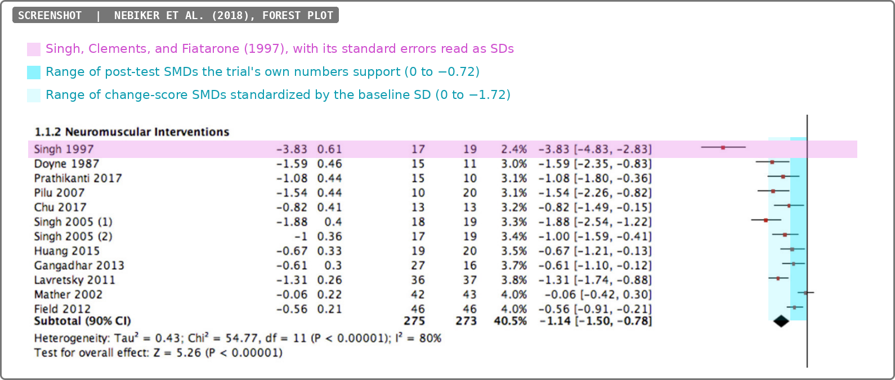
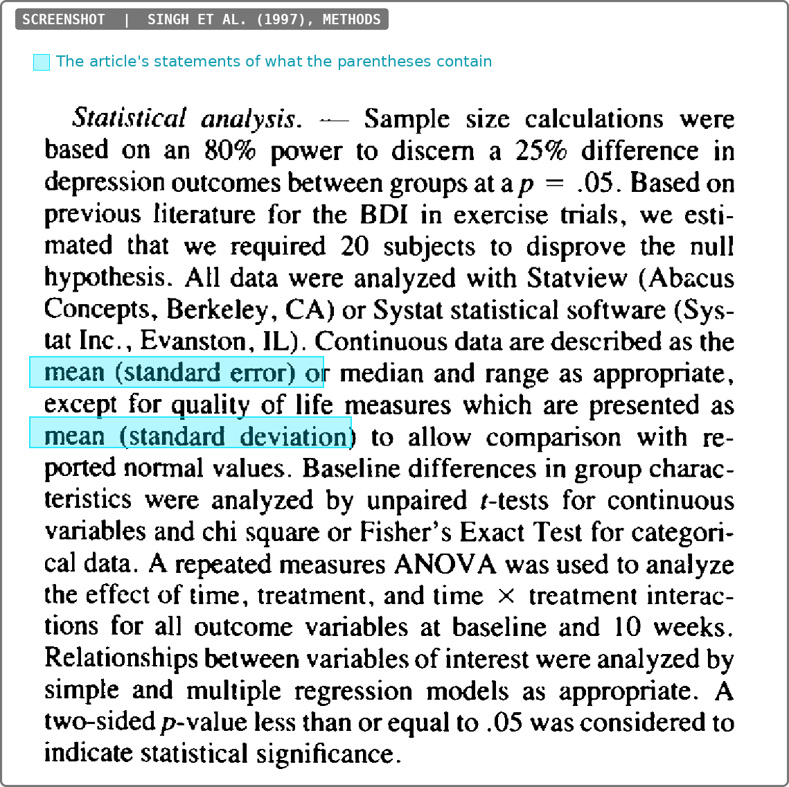
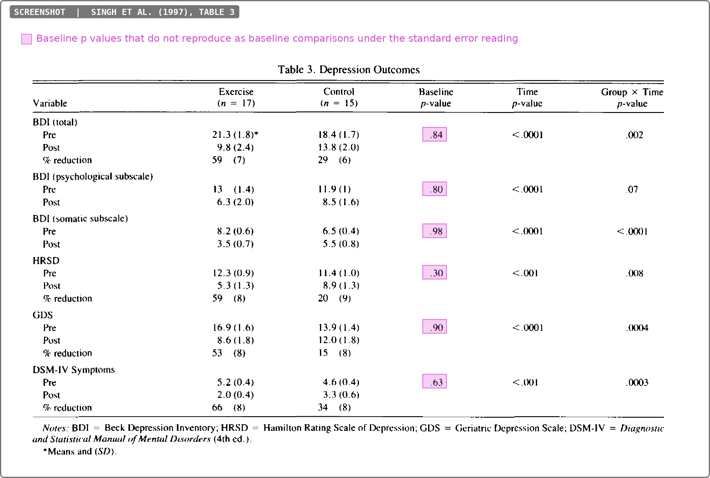
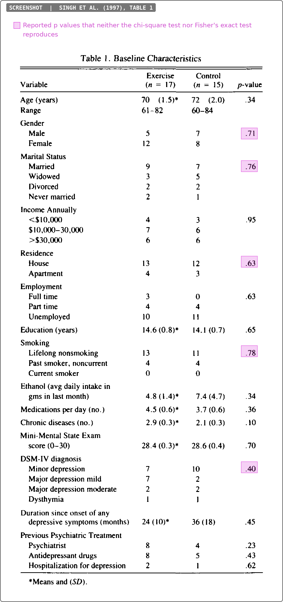
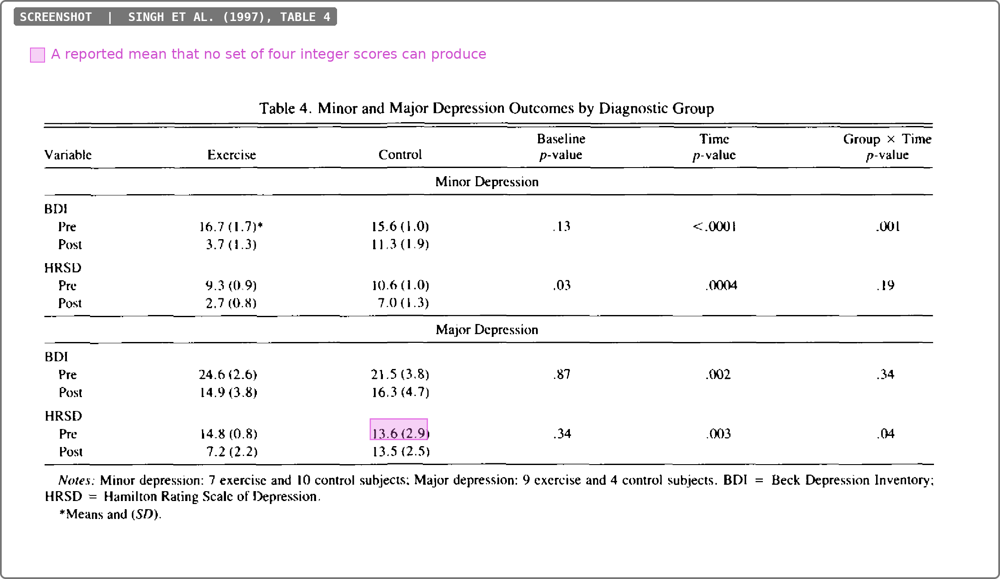

```{r}
#| include: false

# Shared, cosmetic: plot theme and ACE colors (safe to evolve site-wide).
source("reports/helpers/themes.R")
# Frozen, per report: the analysis functions that produce findings.
# (execute-dir is the project root, hence the full path.)
source("reports/ACE2026002/helpers.R")

library(dplyr)
library(tibble)
library(scrutiny)
library(tinytable)
```

\clearpage


<!-- ######################### -->
<!-- ######################### -->
<!-- START REPORT WRITING HERE -->
<!-- ######################### -->
<!-- ######################### -->


## Executive summary


### Description of audited study

This report audits @singh1997, a highly cited RCT of progressive resistance training as a treatment for depression in older adults. The trial has two arms. The exercise arm received 10 weeks of high-intensity resistance training, three sessions per week ($n = 17$). The attention control arm attended an interactive health education program twice a week for 10 weeks ($n = 15$). Subjects were community-dwelling volunteers aged 60 to 84 who met DSM-IV criteria for major depression, minor depression, or dysthymia. Depression was measured at baseline and at 10 weeks (post-intervention) with the Beck Depression Inventory (BDI), the Hamilton Rating Scale for Depression (HRSD), the Geriatric Depression Scale (GDS), and a count of DSM-IV symptoms. The article also reports quality of life (SF-36), self-efficacy, morale, strength, and physical function. All 32 subjects completed the trial. The authors conclude that resistance training is an effective antidepressant in depressed elders.

The trial was one of the first RCTs of resistance training for depression. Meta-analyses of exercise and depression have included @singh1997 for nearly three decades. The problems documented in this report concern how the summary statistics are labeled and reported. Those summary statistics are the values that meta-analyses extract.


### Impact of audited study

```{r}
#| label: impact-numbers
#| include: false
# Totals for the prose below, from the same CSV as @tbl-impact
# (reports/ACE2026002/data/citations.csv, written by scripts/citations.py).
cites <- read.csv("reports/ACE2026002/data/citations.csv")
impact <- list(
  cited      = sum(cites$total),
  reviews    = sum(cites$reviews),
  spread     = if ("reviews_downstream" %in% names(cites)) sum(cites$reviews_downstream) else NA,
  guidelines = if ("spread_guidelines" %in% names(cites)) sum(cites$spread_guidelines)
               else sum(cites$guidelines) + sum(cites$downstream_guidelines),
  retrieved  = cites$retrieved[1]
)
```

We call a work that cites the audited study *infected*, because its findings incorporate results that this report identifies as unreliable. According to OpenAlex (retrieved `r impact$retrieved`), `r impact$cited` articles cite the study (infected articles). Of these, `r impact$reviews` are meta-analyses or reviews (infected reviews). The infected reviews have themselves been cited `r impact$spread` times, which measures how far the audited results have spread through the evidence base. The audited study or an infected review is cited by `r impact$guidelines` clinical guidelines or consensus statements (see @tbl-impact).

```{r}
#| label: impact-table
#| results: asis
#| echo: false
# Counts come from reports/ACE2026002/data/citations.csv, written by
#   python3 scripts/citations.py reports/ACE2026002/index.qmd
# (OpenAlex). Rendering reads the file only; re-run the script to refresh.
cites <- citation_table(
  "reports/ACE2026002/data/citations.csv",
  labels = c("10.1093/gerona/52A.1.M27" = "@singh1997"),
  caption = "Citation counts for the audited study",
  label = "tbl-impact"
)
```


```{r}
#| label: singh-data
#| include: false

# Every number in the findings below is computed here from the values reported
# in the article (the screenshots in the findings below), so the text reports what the tests return rather than
# transcribed results. Counts, means, and the values reported in parentheses
# are entered exactly as published; `reported` holds the probability values
# the article reports.

n_ex <- 17
n_ct <- 15

# Probability value formatted as the article reports them, without the
# leading zero.
fmt_p <- function(p, digits = 2) {
  sub("^0", "", formatC(round(p, digits), format = "f", digits = digits))
}
fmt_n <- function(x, digits = 1) formatC(x, format = "f", digits = digits)
# A value the way the article reports it: one decimal, or none when the
# reported value is a whole number ("70", "13", "10").
as_reported <- function(x) sub("\\.0$", "", formatC(x, format = "f", digits = 1))
reported_pair <- function(m, v) paste0(as_reported(m), " (", as_reported(v), ")")

# Does a recomputed value round to the value the article reports, at the
# precision the article used? `reports_as` is exact agreement at that
# precision; `near_report` allows one unit in the last reported digit, which is
# the most a recomputation from already-rounded summaries can be held to.
p_digits <- function(reported) if (isTRUE(all.equal(round(reported, 2), reported))) 2 else 3
reports_as <- function(computed, reported) {
  any(round(computed, p_digits(reported)) == reported)
}
near_report <- function(computed, reported) {
  d <- p_digits(reported)
  any(abs(round(computed, d) - reported) <= 10^(-d) + 1e-12)
}

# Two-sample t test from published summaries, pooled variance (Student) and
# unpooled (Welch). The article says baseline differences were tested with
# unpaired t tests and does not say which; both are computed throughout.
p_t <- function(m1, s1, n1, m2, s2, n2) {
  sp <- sqrt(((n1 - 1) * s1^2 + (n2 - 1) * s2^2) / (n1 + n2 - 2))
  2 * pt(-abs((m1 - m2) / (sp * sqrt(1 / n1 + 1 / n2))), n1 + n2 - 2)
}
p_welch <- function(m1, s1, n1, m2, s2, n2) {
  v1 <- s1^2 / n1; v2 <- s2^2 / n2
  df <- (v1 + v2)^2 / (v1^2 / (n1 - 1) + v2^2 / (n2 - 1))
  2 * pt(-abs((m1 - m2) / sqrt(v1 + v2)), df)
}
# Both readings of a parenthetical value v: as the SD itself, and as an SE,
# which implies SD = v * sqrt(n).
p_both <- function(m1, v1, n1, m2, v2, n2) {
  c(sd_pooled = p_t(m1, v1, n1, m2, v2, n2),
    sd_welch  = p_welch(m1, v1, n1, m2, v2, n2),
    se_pooled = p_t(m1, v1 * sqrt(n1), n1, m2, v2 * sqrt(n2), n2),
    se_welch  = p_welch(m1, v1 * sqrt(n1), n1, m2, v2 * sqrt(n2), n2))
}

# Half-width of the rounding interval of a value as the article reports it:
# half a unit for values reported as whole numbers of 10 or more ("70",
# "24 (10)", "45.3 (24)"), half of a tenth otherwise.
half_unit <- function(x) ifelse(x == round(x) & x >= 10, 0.5, 0.05)
# The lowest and highest p a test can return once every reported mean and
# parenthetical value is allowed to sit anywhere in its rounding interval,
# with the parenthetical read as an SD (as_se = FALSE) or an SE. The extremes
# lie at the corners of the four intervals, so the 16 corners are enough.
p_range <- function(m1, v1, n1, m2, v2, n2, as_se, test = p_t) {
  k1 <- if (as_se) sqrt(n1) else 1
  k2 <- if (as_se) sqrt(n2) else 1
  g <- expand.grid(a = c(-1, 1), b = c(-1, 1), c = c(-1, 1), d = c(-1, 1))
  ps <- mapply(function(a, b, c, d) test(m1 + a * half_unit(m1), (v1 + b * half_unit(v1)) * k1, n1,
                                         m2 + c * half_unit(m2), (v2 + d * half_unit(v2)) * k2, n2),
               g$a, g$b, g$c, g$d)
  range(ps)
}
in_range <- function(reported, rng) reported >= rng[1] - 1e-12 & reported <= rng[2] + 1e-12
# A signed value with a true minus sign rather than a hyphen.
fmt_es <- function(x, digits = 2) sub("^-", "−", fmt_n(x, digits))

# Every test that could reasonably have produced a categorical comparison:
# Pearson's chi-squared with and without Yates' correction, the likelihood
# ratio (G) test, and Fisher's exact test, which is the Fisher-Freeman-Halton
# test for tables larger than 2 by 2.
p_g <- function(tab) {
  tab <- as.matrix(tab)
  e <- outer(rowSums(tab), colSums(tab)) / sum(tab)
  g <- 2 * sum(ifelse(tab > 0, tab * log(tab / e), 0))
  pchisq(g, (nrow(tab) - 1) * (ncol(tab) - 1), lower.tail = FALSE)
}
p_cat <- function(tab) {
  tab <- as.matrix(tab)
  out <- list(chisq  = suppressWarnings(chisq.test(tab, correct = FALSE)$p.value),
              g      = p_g(tab),
              fisher = fisher.test(tab)$p.value)
  out$yates <- if (all(dim(tab) == c(2, 2))) suppressWarnings(chisq.test(tab, correct = TRUE)$p.value) else NA_real_
  out
}

# Hedges' g for a post-test difference, exercise minus control.
hedges_g <- function(m1, s1, n1, m2, s2, n2) {
  sp <- sqrt(((n1 - 1) * s1^2 + (n2 - 1) * s2^2) / (n1 + n2 - 2))
  ((m1 - m2) / sp) * (1 - 3 / (4 * (n1 + n2) - 9))
}

# The largest range n observations can have when their standard deviation is
# s: two observations at the extremes and the rest at the mean. Any reported
# range wider than this cannot come from a data set with that SD.
max_range <- function(s, n) s * sqrt(2 * (n - 1))

# A floor on a whole-group SD from the means of its subgroups. The total sum
# of squares is the within-subgroup sum of squares plus the between-subgroup
# sum of squares, and only the second is needed for a lower bound. Every
# reported mean is allowed to sit anywhere in its rounding interval, in the
# direction that shrinks the bound, so the floor is conservative. Subjects in
# no listed subgroup contribute nothing to the bound, which lowers it further.
sd_floor <- function(total_mean, N, n_sub, m_sub, half = 0.05) {
  best <- Inf
  for (gm in total_mean + c(-half, 0, half)) {
    m_adj <- m_sub - sign(m_sub - gm) * pmin(half, abs(m_sub - gm))
    best <- min(best, sqrt(sum(n_sub * (m_adj - gm)^2) / (N - 1)))
  }
  best
}

# --- Table 1: baseline characteristics -------------------------------------
t1_cont <- tribble(
  ~variable,                        ~m_ex, ~v_ex, ~m_ct, ~v_ct, ~reported,
  "Age (years)",                     70,    1.5,   72,    2.0,   .34,
  "Education (years)",               14.6,  0.8,   14.1,  0.7,   .65,
  "Ethanol (g per day)",             4.8,   1.4,   7.4,   4.7,   .34,
  "Medications per day",             4.5,   0.6,   3.7,   0.6,   .36,
  "Chronic diseases",                2.9,   0.3,   2.1,   0.3,   .10,
  "Mini-Mental State Exam",          28.4,  0.3,   28.6,  0.4,   .70,
  "Duration of symptoms (months)",   24,    10,    36,    18,    .45
)

# Age: the mean, the parenthetical value, and the range reported beneath it,
# per group in Table 1 and for the whole sample in the abstract.
age_range <- tribble(
  ~where,                   ~n,  ~v,   ~lo, ~hi,
  "Table 1, exercise",      17,  1.5,  61,  82,
  "Table 1, control",       15,  2.0,  60,  84,
  "Abstract, all subjects", 32,  1.2,  60,  84
)

# Categorical rows: one matrix per variable, rows are categories, columns are
# exercise then control. The "current smoker" row is 0 and 0 and is dropped,
# since an empty category contributes nothing to any of these tests.
t1_cat <- list(
  "Gender"                     = list(tab = matrix(c(5, 12,  7, 8), ncol = 2),              reported = .71),
  "Marital status"             = list(tab = matrix(c(9, 3, 2, 2,  7, 5, 2, 1), ncol = 2),   reported = .76),
  "Income"                     = list(tab = matrix(c(4, 7, 6,  3, 6, 6), ncol = 2),         reported = .95),
  "Residence"                  = list(tab = matrix(c(13, 4,  12, 3), ncol = 2),             reported = .63),
  "Employment"                 = list(tab = matrix(c(3, 4, 10,  0, 4, 11), ncol = 2),       reported = .63),
  "Smoking"                    = list(tab = matrix(c(13, 4,  11, 4), ncol = 2),             reported = .78),
  "DSM-IV diagnosis"           = list(tab = matrix(c(7, 7, 2, 1,  10, 2, 2, 1), ncol = 2),  reported = .40),
  "Psychiatrist"               = list(tab = matrix(c(8, 9,  4, 11), ncol = 2),              reported = .23),
  "Antidepressant drugs"       = list(tab = matrix(c(8, 9,  5, 10), ncol = 2),              reported = .43),
  "Hospitalization"            = list(tab = matrix(c(2, 15,  1, 14), ncol = 2),             reported = .62)
)

# Comparisons of proportions stated in the Results text, with the p value
# the text gives. These identify the test the authors used. Each matrix has
# the responders in the first row, non-responders in the second, exercise in
# the first column and control in the second.
text_props <- tribble(
  ~claim,                                           ~reported,
  "Response to treatment, 10 of 17 vs 4 of 15",     .067,
  "Minor depression remitted, 6 of 7 vs 4 of 10",   .06,
  "Major depression remitted, 8 of 9 vs 2 of 4",    .12
)
text_tabs <- list(
  matrix(c(10, 7,  4, 11), ncol = 2),
  matrix(c(6, 1,  4, 6), ncol = 2),
  matrix(c(8, 1,  2, 2), ncol = 2)
)

# --- Table 3: depression outcomes, whole groups -----------------------------
t3 <- tribble(
  ~outcome,             ~pre_ex, ~vpre_ex, ~post_ex, ~vpost_ex, ~pre_ct, ~vpre_ct, ~post_ct, ~vpost_ct, ~reported,
  "BDI total",           21.3,    1.8,      9.8,      2.4,       18.4,    1.7,      13.8,     2.0,       .84,
  "BDI psychological",   13.0,    1.4,      6.3,      2.0,       11.9,    1.0,      8.5,      1.6,       .80,
  "BDI somatic",         8.2,     0.6,      3.5,      0.7,       6.5,     0.4,      5.5,      0.8,       .98,
  "HRSD",                12.3,    0.9,      5.3,      1.3,       11.4,    1.0,      8.9,      1.3,       .30,
  "GDS",                 16.9,    1.6,      8.6,      1.8,       13.9,    1.4,      12.0,     1.8,       .90,
  "DSM-IV symptoms",     5.2,     0.4,      2.0,      0.4,       4.6,     0.4,      3.3,      0.6,       .63
)

# --- Table 4: depression outcomes by diagnostic subgroup --------------------
# Minor depression: 7 exercise and 10 control; major depression: 9 exercise
# and 4 control (the table notes). The one dysthymic subject in each group is
# in neither subgroup.
t4 <- tribble(
  ~subgroup,          ~outcome, ~time,  ~m_ex, ~v_ex, ~n_ex, ~m_ct, ~v_ct, ~n_ct, ~reported,
  "Minor depression", "BDI",    "Pre",  16.7,  1.7,   7,     15.6,  1.0,   10,    .13,
  "Minor depression", "BDI",    "Post", 3.7,   1.3,   7,     11.3,  1.9,   10,    NA,
  "Minor depression", "HRSD",   "Pre",  9.3,   0.9,   7,     10.6,  1.0,   10,    .03,
  "Minor depression", "HRSD",   "Post", 2.7,   0.8,   7,     7.0,   1.3,   10,    NA,
  "Major depression", "BDI",    "Pre",  24.6,  2.6,   9,     21.5,  3.8,   4,     .87,
  "Major depression", "BDI",    "Post", 14.9,  3.8,   9,     16.3,  4.7,   4,     NA,
  "Major depression", "HRSD",   "Pre",  14.8,  0.8,   9,     13.6,  2.9,   4,     .34,
  "Major depression", "HRSD",   "Post", 7.2,   2.2,   9,     13.5,  2.5,   4,     NA
)

# --- Table 5: quality of life (SF-36), the one table whose parenthetical
# values the Methods identify as standard deviations ----------------------------
t5 <- tribble(
  ~subscale,              ~pre_ex, ~sd_pre_ex, ~post_ex, ~sd_post_ex, ~pre_ct, ~sd_pre_ct, ~post_ct, ~sd_post_ct, ~reported,
  "Physical functioning",  65.9,    23.5,       82.6,     18.4,        64.3,    24.9,       70.3,     27.8,        .34,
  "Role physical",         52.9,    34.0,       73.5,     42.8,        63.3,    44.2,       61.7,     44.2,        .95,
  "Bodily pain",           56.8,    26.9,       74.2,     19.0,        72.3,    31.0,       58.5,     28.6,        .98,
  "General health",        54.0,    17.5,       63.9,     26.5,        64.9,    24.8,       63.5,     23.9,        .49,
  "Vitality",              37.6,    17.9,       61.7,     25.3,        45.3,    24.0,       48.7,     27.5,        .73,
  "Social functioning",    51.5,    25.0,       82.4,     19.3,        69.2,    26.2,       70.8,     26.2,        .66,
  "Role emotional",        43.1,    35.0,       76.5,     32.8,        60.0,    42.2,       62.2,     43.4,        .91,
  "Mental health",         55.5,    20.3,       71.8,     26.5,        57.0,    18.7,       66.1,     22.6,        .80
)

# Correlations stated in the Results text for the exercise group (n = 17).
text_cors <- tribble(
  ~claim,                                  ~r,     ~reported,
  "Intensity of training and BDI change",  -.786,  .0002,
  "Compliance and BDI change",             -.589,  .013,
  "Baseline BDI and BDI change",            .500,  .04
)
```


```{r}
#| label: singh-analyses
#| include: false

# ---- 1. Standard errors labeled as standard deviations ----------------------

# 1a. The age ranges Table 1 and the abstract report beside the age SDs.
age_range <- age_range |>
  mutate(max_if_sd = max_range(v + 0.05, n),      # the reported value at the top of its rounding interval
         span      = hi - lo,
         sd_if_se  = v * sqrt(n))

# 1b. Table 1 continuous rows: reported p against both readings. For each
#     reading, the full range each t test can return over the rounding
#     intervals of the reported values; a reported value reproduces when it
#     falls inside either test's range.
with_ranges <- function(d, m1, v1, m2, v2) {
  d |>
    rowwise() |>
    mutate(sd_student = list(p_range(.data[[m1]], .data[[v1]], n_ex, .data[[m2]], .data[[v2]], n_ct, FALSE, p_t)),
           sd_welch   = list(p_range(.data[[m1]], .data[[v1]], n_ex, .data[[m2]], .data[[v2]], n_ct, FALSE, p_welch)),
           se_student = list(p_range(.data[[m1]], .data[[v1]], n_ex, .data[[m2]], .data[[v2]], n_ct, TRUE,  p_t)),
           se_welch   = list(p_range(.data[[m1]], .data[[v1]], n_ex, .data[[m2]], .data[[v2]], n_ct, TRUE,  p_welch))) |>
    ungroup() |>
    mutate(sd_reproduces = mapply(function(a, b, rep) in_range(rep, a) | in_range(rep, b), sd_student, sd_welch, reported),
           se_reproduces = mapply(function(a, b, rep) in_range(rep, a) | in_range(rep, b), se_student, se_welch, reported))
}
t1_tests <- t1_cont |>
  rowwise() |>
  mutate(res = list(p_both(m_ex, v_ex, n_ex, m_ct, v_ct, n_ct))) |>
  ungroup() |>
  mutate(as_sd = sapply(res, function(r) r[["sd_pooled"]]),
         as_se = sapply(res, function(r) r[["se_pooled"]]),
         as_se_welch = sapply(res, function(r) r[["se_welch"]])) |>
  with_ranges("m_ex", "v_ex", "m_ct", "v_ct")
t1_se_hits <- sum(t1_tests$se_reproduces)
t1_sd_hits <- sum(t1_tests$sd_reproduces)
t1_se_fail <- t1_tests$variable[!t1_tests$se_reproduces]
rep_of <- function(name) t1_cont$reported[t1_cont$variable == name]

# 1c. Table 3 whole-group values against the Table 4 subgroup means. For
#     each group and time point, the smallest SD the whole group can have
#     given the means of its minor and major depression subgroups.
sub_means <- t4 |>
  filter(outcome %in% c("BDI", "HRSD")) |>
  group_by(outcome, time) |>
  summarise(
    ex_n = list(n_ex), ex_m = list(m_ex),
    ct_n = list(n_ct), ct_m = list(m_ct),
    .groups = "drop"
  )
t3_floor <- t3 |>
  filter(outcome %in% c("BDI total", "HRSD")) |>
  mutate(outcome_key = ifelse(outcome == "BDI total", "BDI", "HRSD")) |>
  tidyr::pivot_longer(c(pre_ex, post_ex, pre_ct, post_ct), names_to = "cell", values_to = "mean") |>
  mutate(time = ifelse(grepl("^pre", cell), "Pre", "Post"),
         group = ifelse(grepl("_ex$", cell), "Exercise", "Control"),
         parenthetical = case_when(cell == "pre_ex" ~ vpre_ex, cell == "post_ex" ~ vpost_ex,
                             cell == "pre_ct" ~ vpre_ct, TRUE ~ vpost_ct),
         N = ifelse(group == "Exercise", n_ex, n_ct)) |>
  select(outcome, outcome_key, time, group, mean, parenthetical, N) |>
  left_join(sub_means, by = c("outcome_key" = "outcome", "time")) |>
  rowwise() |>
  mutate(floor = if (group == "Exercise") sd_floor(mean, N, ex_n, ex_m) else sd_floor(mean, N, ct_n, ct_m),
         implied_sd = parenthetical * sqrt(N),
         possible_as_sd = parenthetical + 0.05 >= floor) |>   # the reported value at the top of its rounding interval
  ungroup() |>
  select(outcome, group, time, mean, parenthetical, floor, implied_sd, possible_as_sd)
t3_floor_fail <- sum(!t3_floor$possible_as_sd)

# 1d. What the tables imply for an effect size, read either way.
smd <- t3 |>
  mutate(g_as_sd = hedges_g(post_ex, vpost_ex, n_ex, post_ct, vpost_ct, n_ct),
         g_as_se = hedges_g(post_ex, vpost_ex * sqrt(n_ex), n_ex, post_ct, vpost_ct * sqrt(n_ct), n_ct),
         ratio   = g_as_sd / g_as_se,
         # change scores standardized by the pooled baseline SD (Morris's
         # d_ppc2 with the small-sample correction), under both readings
         change_ex = post_ex - pre_ex,
         change_ct = post_ct - pre_ct,
         gc_as_sd  = hedges_g(change_ex, vpre_ex, n_ex, change_ct, vpre_ct, n_ct),
         gc_as_se  = hedges_g(change_ex, vpre_ex * sqrt(n_ex), n_ex, change_ct, vpre_ct * sqrt(n_ct), n_ct))

# ---- 2. The "Baseline p-value" column ----------------------------------------

# 2a. Table 5, where the Methods say the parentheticals are SDs: a test of
#     the baseline scores.
t5_tests <- t5 |>
  rowwise() |>
  mutate(baseline_pooled = p_t(pre_ex, sd_pre_ex, n_ex, pre_ct, sd_pre_ct, n_ct),
         baseline_welch  = p_welch(pre_ex, sd_pre_ex, n_ex, pre_ct, sd_pre_ct, n_ct),
         pre_diff        = pre_ex - pre_ct) |>
  ungroup() |>
  with_ranges("pre_ex", "sd_pre_ex", "pre_ct", "sd_pre_ct") |>
  mutate(baseline_reproduces = sd_reproduces)
t5_baseline_fail <- sum(!t5_tests$baseline_reproduces)
t5_se_fail       <- sum(!t5_tests$se_reproduces)
# How far each reported value sits from the baseline test.
t5_tests <- t5_tests |>
  mutate(gap_baseline = abs(pmin(baseline_pooled, baseline_welch) - reported))
t5_base_far   <- sum(t5_tests$gap_baseline > 0.2)

# 2b. Table 3 under the SE reading: a real baseline test.
t3_tests <- t3 |>
  rowwise() |>
  mutate(baseline_se = p_t(pre_ex, vpre_ex * sqrt(n_ex), n_ex, pre_ct, vpre_ct * sqrt(n_ct), n_ct),
         baseline_se_welch = p_welch(pre_ex, vpre_ex * sqrt(n_ex), n_ex, pre_ct, vpre_ct * sqrt(n_ct), n_ct),
         pre_diff = pre_ex - pre_ct) |>
  ungroup() |>
  with_ranges("pre_ex", "vpre_ex", "pre_ct", "vpre_ct") |>
  mutate(reproduces = se_reproduces)
somatic <- t3_tests |> filter(outcome == "BDI somatic")
t3_baseline_fail <- sum(!t3_tests$reproduces)
t3_sd_fail       <- sum(!t3_tests$sd_reproduces)

# ---- 3. Categorical baseline tests -------------------------------------------

# 3a. Which test did the authors use? The three proportions in the Results
#     text are the only comparisons whose test can be identified.
text_res <- lapply(text_tabs, p_cat)
text_tests <- text_props |>
  mutate(chisq  = sapply(text_res, `[[`, "chisq"),
         yates  = sapply(text_res, `[[`, "yates"),
         g      = sapply(text_res, `[[`, "g"),
         fisher = sapply(text_res, `[[`, "fisher"),
         chisq_reproduces = mapply(reports_as, chisq, reported))
text_chisq_hits <- sum(text_tests$chisq_reproduces)

# 3b. Table 1 categorical rows.
cat_res <- lapply(t1_cat, function(x) p_cat(x$tab))
cat_tests <- tibble(
  variable = names(t1_cat),
  reported = sapply(t1_cat, `[[`, "reported"),
  chisq    = sapply(cat_res, `[[`, "chisq"),
  yates    = sapply(cat_res, `[[`, "yates"),
  g        = sapply(cat_res, `[[`, "g"),
  fisher   = sapply(cat_res, `[[`, "fisher")
) |>
  mutate(reproduces = mapply(function(a, b, c, d, rep) near_report(na.omit(c(a, b, c, d)), rep),
                             chisq, yates, g, fisher, reported),
         yates_reproduces = mapply(function(y, rep) !is.na(y) && near_report(y, rep), yates, reported))
stopifnot(!any(cat_tests$yates_reproduces))
cat_fail <- cat_tests |> filter(!reproduces)

# 3c. Before a value is counted as wrong, every way of merging the row's
#     categories into fewer groups is tried as well (every set partition of
#     the rows), under all four tests. A reported value that any merged version
#     of the reported counts can produce is not counted, although the article
#     describes no merging.
set_partitions <- function(k) {
  if (k == 1) return(list(list(1L)))
  out <- list()
  for (p in set_partitions(k - 1)) {
    for (i in seq_along(p)) {
      q <- p
      q[[i]] <- c(q[[i]], k)
      out[[length(out) + 1]] <- q
    }
    out[[length(out) + 1]] <- c(p, list(k))
  }
  out
}
collapse_tab <- function(tab, part) {
  t(sapply(part, function(rows) colSums(tab[rows, , drop = FALSE])))
}
merged_matches <- function(tab, reported) {
  parts <- Filter(function(p) length(p) >= 2, set_partitions(nrow(tab)))
  hits <- vapply(parts, function(p) {
    r <- p_cat(collapse_tab(tab, p))
    near_report(na.omit(unlist(r)), reported)
  }, logical(1))
  any(hits)
}
cat_tests <- cat_tests |>
  mutate(any_merging = sapply(variable, function(v) merged_matches(t1_cat[[v]]$tab, t1_cat[[v]]$reported)))
cat_counted <- cat_tests |> filter(!any_merging)
employment_collapsed <- p_cat(matrix(c(7, 10,  4, 11), ncol = 2))
employment_matches_collapsed <- near_report(employment_collapsed$yates, t1_cat[["Employment"]]$reported)

# ---- 4. GRIM on the subgroup means ------------------------------------------

# Only subgroups small enough for a one-decimal GRIM test to be able to fail
# are tested: with n of 10 or more, every value to one decimal place is an
# achievable mean (1/n is at most 0.1), so the test has nothing to say.
grim_input <- t4 |>
  select(subgroup, outcome, time, m_ex, n_ex, m_ct, n_ct) |>
  tidyr::pivot_longer(c(m_ex, m_ct), names_to = "group", values_to = "mean") |>
  mutate(n = ifelse(group == "m_ex", n_ex, n_ct),
         group = ifelse(group == "m_ex", "Exercise", "Control"),
         x = formatC(mean, format = "f", digits = 1)) |>
  filter(n < 10) |>
  select(subgroup, outcome, time, group, x, n)
grim_results <- scrutiny::grim_map(grim_input |> select(x, n))
grim_table <- grim_input |>
  mutate(Consistent = ifelse(grim_results$consistency, "Yes", "No")) |>
  rename(Subgroup = subgroup, Outcome = outcome, Time = time, Group = group, Mean = x)
grim_fail <- grim_table |> filter(Consistent == "No")

# ---- 5. What reproduces: the correlations in the text ---------------------
text_cors <- text_cors |>
  mutate(t = abs(r) * sqrt(n_ex - 2) / sqrt(1 - r^2),
         p = 2 * pt(-t, n_ex - 2),
         reproduces = mapply(near_report, p, reported))

# ---- What the prose states as fact, checked against the numbers above --------
# The sentences below assert each of these. They are tested here rather than
# written into the sentences, so the report fails to render if a correction
# to the extracted values ever contradicts what the text says.
# 1d. Every other table with the same "Means and (SD)" label. A value counts
#     only where a reported test statistic separates the two readings. In a
#     two-group, two-time repeated measures ANOVA the Group x Time p is the
#     t test on change scores; the change SD depends on the unreported
#     pre-post correlation r, so r may take any value in [-1, 1], separately
#     in each group, and every mean and parenthetical value may sit anywhere
#     in its rounding interval. That gives the widest p range each reading can
#     produce. Table 2 reports unpaired comparisons (Student and Welch). Table
#     5, whose values the Methods call SDs, is the control.
sdse_iv <- function(x) {
  x <- trimws(x)
  d <- if (grepl(".", x, fixed = TRUE)) nchar(sub(".*\\.", "", x)) else 0
  v <- as.numeric(x); h <- 0.5 * 10^(-d)
  c(v - h, v + h)
}
sdse_piv <- function(x) {
  x <- trimws(x)
  if (startsWith(x, "<")) c(0, as.numeric(substring(x, 2))) else sdse_iv(x)
}
sdse_p <- function(t, df) if (is.finite(t)) 2 * pt(abs(t), df, lower.tail = FALSE) else 0
sdse_interaction <- function(v, n1, n2, as_se) {   # v: pre, (pre), post, (post), exercise then control
  k1 <- if (as_se) sqrt(n1) else 1; k2 <- if (as_se) sqrt(n2) else 1
  m <- lapply(v[c(1, 3, 5, 7)], sdse_iv)
  dlo <- (m[[2]][1] - m[[1]][2]) - (m[[4]][2] - m[[3]][1])
  dhi <- (m[[2]][2] - m[[1]][1]) - (m[[4]][1] - m[[3]][2])
  dmin <- if (dlo <= 0 && dhi >= 0) 0 else min(abs(dlo), abs(dhi))
  dmax <- max(abs(dlo), abs(dhi))
  csd <- function(a, b, k) { a <- a * k; b <- b * k; c(max(0, a[1] - b[2], b[1] - a[2]), a[2] + b[2]) }
  c1 <- csd(sdse_iv(v[2]), sdse_iv(v[4]), k1)
  c2 <- csd(sdse_iv(v[6]), sdse_iv(v[8]), k2)
  df <- n1 + n2 - 2; f <- sqrt(1 / n1 + 1 / n2)
  sp <- function(a, b) sqrt(((n1 - 1) * a^2 + (n2 - 1) * b^2) / df)
  spmin <- sp(c1[1], c2[1]); spmax <- sp(c1[2], c2[2])
  c(sdse_p(if (spmin > 0) dmax / (spmin * f) else Inf, df), sdse_p(dmin / (spmax * f), df))
}
sdse_unpaired <- function(v, n1, n2, as_se) {   # v: mean, (value), exercise then control
  k1 <- if (as_se) sqrt(n1) else 1; k2 <- if (as_se) sqrt(n2) else 1
  a <- sdse_iv(v[1]); b <- sdse_iv(v[3])
  dmin <- max(0, a[1] - b[2], b[1] - a[2]); dmax <- max(a[2] - b[1], b[2] - a[1])
  lo <- 1; hi <- 0
  for (s1 in sdse_iv(v[2]) * k1) for (s2 in sdse_iv(v[4]) * k2) {
    df <- n1 + n2 - 2
    se_p <- sqrt(((n1 - 1) * s1^2 + (n2 - 1) * s2^2) / df * (1 / n1 + 1 / n2))
    se_w <- sqrt(s1^2 / n1 + s2^2 / n2)
    df_w <- se_w^4 / ((s1^2 / n1)^2 / (n1 - 1) + (s2^2 / n2)^2 / (n2 - 1))
    lo <- min(lo, sdse_p(dmax / se_p, df), sdse_p(dmax / se_w, df_w))
    hi <- max(hi, sdse_p(dmin / se_p, df), sdse_p(dmin / se_w, df_w))
  }
  c(lo, hi)
}
# Generous rounding: each range is shown at the precision of the reported
# value, its lower end rounded down and its upper end rounded up, and a
# reported value reproduces when it falls inside the range as shown.
p_decimals <- function(rep) { r <- sub("^<", "", trimws(rep)); nchar(sub(".*\\.", "", r)) }
p_bounds <- function(rng, rep) {
  f <- 10^p_decimals(rep)
  c(floor(rng[1] * f + 1e-9) / f, ceiling(rng[2] * f - 1e-9) / f)
}
sdse_hit <- function(rng, rep) {
  b <- p_bounds(rng, rep)
  if (startsWith(trimws(rep), "<")) b[1] <= as.numeric(sub("^<", "", trimws(rep))) + 1e-12
  else b[1] - 1e-12 <= as.numeric(rep) && as.numeric(rep) <= b[2] + 1e-12
}
# Column headers say p wherever the column holds p-values, italic in both formats.
p_hdr <- function(x) sprintf(x, if (knitr::is_latex_output()) "\\textit{p}" else "<i>p</i>")
fmt_prange <- function(rng, rep) {
  d <- p_decimals(rep); b <- p_bounds(rng, rep)
  f <- function(x) { v <- formatC(x, format = "f", digits = d); if (x < 1) sub("^0", "", v) else v }
  if (b[1] == b[2]) f(b[1]) else paste0(f(b[1]), "–", f(b[2]))
}

sdse_rows <- list(
  # table, variable, test, n exercise, n control, values, reported p
  list("Table 1", "Age (years)",                   "t", 17, 15, c("70", "1.5", "72", "2.0"), ".34"),
  list("Table 1", "Education (years)",             "t", 17, 15, c("14.6", "0.8", "14.1", "0.7"), ".65"),
  list("Table 1", "Ethanol (g per day)",           "t", 17, 15, c("4.8", "1.4", "7.4", "4.7"), ".34"),
  list("Table 1", "Medications per day",           "t", 17, 15, c("4.5", "0.6", "3.7", "0.6"), ".36"),
  list("Table 1", "Chronic diseases",              "t", 17, 15, c("2.9", "0.3", "2.1", "0.3"), ".10"),
  list("Table 1", "Mini-Mental State Exam",        "t", 17, 15, c("28.4", "0.3", "28.6", "0.4"), ".70"),
  list("Table 1", "Duration of symptoms (months)", "t", 17, 15, c("24", "10", "36", "18"), ".45"),
  list("Table 2", "Visits to a health professional", "t", 17, 15, c("2.1", "0.4", "2.0", "0.5"), ".90"),
  list("Table 2", "Minor illness",                  "t", 17, 15, c("0.65", "0.2", "0.47", "0.2"), ".50"),
  list("Table 2", "Hospital days",                  "t", 17, 15, c("0.24", "0.2", "0.53", "0.4"), ".40"),
  list("Table 2", "Musculoskeletal pain",           "t", 17, 15, c("5.4", "0.7", "5.6", "0.7"), ".80"),
  list("Table 3", "BDI total",         "gt", 17, 15, c("21.3", "1.8", "9.8", "2.4", "18.4", "1.7", "13.8", "2.0"), ".002"),
  list("Table 3", "BDI psychological", "gt", 17, 15, c("13", "1.4", "6.3", "2.0", "11.9", "1", "8.5", "1.6"), ".07"),
  list("Table 3", "BDI somatic",       "gt", 17, 15, c("8.2", "0.6", "3.5", "0.7", "6.5", "0.4", "5.5", "0.8"), "<.0001"),
  list("Table 3", "HRSD",              "gt", 17, 15, c("12.3", "0.9", "5.3", "1.3", "11.4", "1.0", "8.9", "1.3"), ".008"),
  list("Table 3", "GDS",               "gt", 17, 15, c("16.9", "1.6", "8.6", "1.8", "13.9", "1.4", "12.0", "1.8"), ".0004"),
  list("Table 3", "DSM-IV symptoms",   "gt", 17, 15, c("5.2", "0.4", "2.0", "0.4", "4.6", "0.4", "3.3", "0.6"), ".0003"),
  list("Table 4", "Minor depression, BDI",  "gt", 7, 10, c("16.7", "1.7", "3.7", "1.3", "15.6", "1.0", "11.3", "1.9"), ".001"),
  list("Table 4", "Minor depression, HRSD", "gt", 7, 10, c("9.3", "0.9", "2.7", "0.8", "10.6", "1.0", "7.0", "1.3"), ".19"),
  list("Table 4", "Major depression, BDI",  "gt", 9, 4,  c("24.6", "2.6", "14.9", "3.8", "21.5", "3.8", "16.3", "4.7"), ".34"),
  list("Table 4", "Major depression, HRSD", "gt", 9, 4,  c("14.8", "0.8", "7.2", "2.2", "13.6", "2.9", "13.5", "2.5"), ".04"),
  list("Table 5", "Physical functioning", "gt", 17, 15, c("65.9", "23.5", "82.6", "18.4", "64.3", "24.9", "70.3", "27.8"), ".22"),
  list("Table 5", "Role physical",        "gt", 17, 15, c("52.9", "34.0", "73.5", "42.8", "63.3", "44.2", "61.7", "44.2"), ".16"),
  list("Table 5", "Bodily pain",          "gt", 17, 15, c("56.8", "26.9", "74.2", "19.0", "72.3", "31.0", "58.5", "28.6"), ".001"),
  list("Table 5", "General health",       "gt", 17, 15, c("54.0", "17.5", "63.9", "26.5", "64.9", "24.8", "63.5", "23.9"), ".06"),
  list("Table 5", "Vitality",             "gt", 17, 15, c("37.6", "17.9", "61.7", "25.3", "45.3", "24", "48.7", "27.5"), ".002"),
  list("Table 5", "Social functioning",   "gt", 17, 15, c("51.5", "25.0", "82.4", "19.3", "69.2", "26.2", "70.8", "26.2"), ".008"),
  list("Table 5", "Role emotional",       "gt", 17, 15, c("43.1", "35", "76.5", "32.8", "60.0", "42.2", "62.2", "43.4"), ".02"),
  list("Table 5", "Mental health",        "gt", 17, 15, c("55.5", "20.3", "71.8", "26.5", "57.0", "18.7", "66.1", "22.6"), ".24"),
  list("Table 6", "Lifting",               "gt", 17, 15, c("46.1", "4.4", "51.9", "4.9", "57.8", "6.7", "60.9", "7.0"), ".59"),
  list("Table 6", "Climbing",              "gt", 17, 15, c("50.7", "5.7", "51.4", "5.0", "50.2", "6.3", "47.4", "5.8"), ".63"),
  list("Table 6", "Pushups",               "gt", 17, 15, c("19.8", "4.8", "25.1", "5.7", "15.3", "4.6", "16.6", "3.7"), ".48"),
  list("Table 6", "Jogging",               "gt", 17, 15, c("13.0", "4.3", "20.9", "6.8", "11.5", "2.8", "12.4", "2.7"), ".25"),
  list("Table 6", "Walking",               "gt", 17, 15, c("51.3", "6.6", "51.9", "7.8", "63.9", "7.3", "51.4", "6.0"), ".14"),
  list("Table 6", "Philadelphia Geriatric Morale Scale", "gt", 17, 15, c("5.8", "0.9", "9.9", "1.1", "6.9", "0.8", "8.3", "1.0"), ".03"),
  list("Table 6", "Agitation",             "gt", 17, 15, c("2.7", "0.4", "4.2", "0.5", "3.4", "0.5", "3.9", "0.5"), ".17"),
  list("Table 6", "Attitude toward aging", "gt", 17, 15, c("0.7", "0.2", "2.1", "0.4", "0.9", "0.3", "1.1", "0.3"), ".04"),
  list("Table 6", "Loneliness",            "gt", 17, 15, c("2.4", "0.5", "3.6", "0.5", "2.6", "0.5", "3.3", "0.5"), ".30"),
  list("Table 7", "ADL",                "gt", 17, 14, c("6.3", "0.8", "6.1", "0.8", "6.2", "0.1", "6.1", "0.9"), ".36"),
  list("Table 7", "IADL",               "gt", 17, 14, c("23.4", "0.3", "23.4", "0.4", "23.9", "0.1", "23.9", "0.1"), ".80"),
  list("Table 7", "SIP total",          "gt", 17, 14, c("6.4", "1.8", "3.3", "1.5", "7.4", "2.7", "4.7", "1.8"), ".84"),
  list("Table 7", "Gait speed",         "gt", 17, 14, c("1.10", ".06", "1.2", ".06", "1.1", ".06", "1.1", ".06"), ".32"),
  list("Table 7", "6-minute walk",      "gt", 17, 14, c("1455", "76", "1580", "94", "1500", "87", "1552", "122"), ".36"),
  list("Table 7", "Chair rise, single", "gt", 17, 14, c("1.78", "0.3", "1.35", "0.1", "1.67", "0.2", "2.1", "0.5"), ".06"),
  list("Table 7", "Chair rise, 5 times","gt", 17, 14, c("18.4", "2.4", "16.2", "1.0", "17.2", "1.4", "19.4", "3.1"), ".10"),
  list("Table 7", "Strength",           "gt", 17, 14, c("2469", "165", "3241", "191", "2823", "349", "2756", "334"), "<.0001")
)
sdse <- bind_rows(lapply(sdse_rows, function(r) {
  f <- if (r[[3]] == "t") sdse_unpaired else sdse_interaction
  a <- f(r[[6]], r[[4]], r[[5]], FALSE); b <- f(r[[6]], r[[4]], r[[5]], TRUE)
  tibble(table = r[[1]], variable = r[[2]], test = r[[3]], n_values = length(r[[6]]) / 2,
         reported = r[[7]], sd_lo = a[1], sd_hi = a[2], se_lo = b[1], se_hi = b[2],
         sd_ok = sdse_hit(a, r[[7]]), se_ok = sdse_hit(b, r[[7]]))
})) |>
  mutate(refuted = !sd_ok & se_ok & table != "Table 5")
sdse_ref        <- sdse |> filter(refuted)
sdse_ref_values <- sum(sdse_ref$n_values)            # parenthetical values whose SD label a test refutes
sdse_row <- function(v) sdse |> filter(variable == v)
sdse_neither    <- sdse |> filter(!sd_ok & !se_ok & table != "Table 5")
sdse_hrsd       <- sdse |> filter(table == "Table 3", variable == "HRSD")
sdse_lift       <- sdse |> filter(variable == "Lifting")
sdse_hosp       <- sdse |> filter(variable == "Hospital days")

# The "Baseline p-value" column against a real baseline test, with the
# reading of the parentheticals the article supports: Table 5 as SDs (the
# Methods say so), Table 3 as SEs (@sec-se-sd). Same generous rounding.
base_cmp <- bind_rows(
  t5_tests |> transmute(table = "Table 5", variable = subscale,
                        ex = reported_pair(pre_ex, sd_pre_ex), ct = reported_pair(pre_ct, sd_pre_ct),
                        reported, student = sd_student, welch = sd_welch),
  t3_tests |> transmute(table = "Table 3", variable = outcome,
                        ex = reported_pair(pre_ex, vpre_ex), ct = reported_pair(pre_ct, vpre_ct),
                        reported, student = se_student, welch = se_welch)) |>
  mutate(rep = fmt_p(reported),
         reproduces = mapply(function(a, b, r) sdse_hit(a, r) || sdse_hit(b, r), student, welch, rep))
base_fail <- base_cmp |> filter(!reproduces)

# 1e. Training intensity in the Results: values labeled SD whose ranges do
#     not allow them. n values inside a range of width w have an SD of at
#     most (w / 2) * sqrt(n / (n - 1)); the range endpoints may be rounded by
#     up to half a point each.
sd_max_range <- function(lo, hi, n) ((hi - lo + 1) / 2) * sqrt(n / (n - 1))
intensity <- tibble(
  what = c("All exercisers", "Excluding one subject"),
  n = c(17, 16), mean = c(78, 80), sd = c(24, 10), lo = c(45, 70), hi = c(87, 87)) |>
  mutate(sd_max = sd_max_range(lo, hi, n),
         possible_sd = (sd - 0.5) <= sd_max,
         possible_se = (sd - 0.5) * sqrt(n) <= sd_max)

stopifnot(
  all(age_range$span > age_range$max_if_sd),            # every reported age range is too wide for the reported SD
  t1_sd_hits == 0,                                         # no Table 1 p value reproduces with the parentheticals as SDs, at any point of its rounding interval
  t1_se_hits == 5,                                         # five reproduce with them as SEs once rounding is allowed for
  setequal(t1_se_fail, c("Ethanol (g per day)", "Duration of symptoms (months)")),   # ethanol and duration do not, under either reading
  t3_floor_fail == nrow(t3_floor),                         # every Table 3 BDI and HRSD parenthetical is below its floor
  all(sdse$sd_ok[sdse$table == "Table 5"]),               # the control: every Table 5 Group x Time p reproduces as SDs
  nrow(sdse_ref) == 25, sdse_ref_values == 86,            # 25 variables (86 values) refute the SD label
  setequal(sdse_neither$variable, c("Ethanol (g per day)", "Duration of symptoms (months)", "Hospital days")),
  sum(!base_cmp$reproduces[base_cmp$table == "Table 5"]) == 7,   # seven Table 5 baseline values fail a baseline test
  sum(!base_cmp$reproduces[base_cmp$table == "Table 3"]) == 6,   # all six Table 3 values fail it
  sum(grim_table$Consistent == "No") == 1, nrow(grim_table) == 12,   # one GRIM failure among 12 testable means
  sdse_hrsd$sd_hi < .0001,                                 # HRSD: the SD reading can not reach .0001
  !any(intensity$possible_sd), !any(intensity$possible_se), # both intensity SDs exceed what their ranges allow
  all(abs(smd$ratio - 4) < 0.15),                          # the two readings differ by a factor of about four
  t5_baseline_fail == 7,                                   # seven of the eight Table 5 baseline values fall outside what a baseline test can return
  !any(t5_tests$baseline_reproduces[t5_tests$subscale != "Mental health"]),   # mental health is the one inside
  t5_se_fail == 8,                                         # none reproduce with the SDs read as SEs either
  t5_base_far == 7,                                        # the baseline test is more than 0.2 away on seven
  t3_baseline_fail == nrow(t3),                            # none of Table 3's reproduce as a baseline test under the SE reading
  t3_sd_fail == nrow(t3),                                  # nor under the SD reading
  somatic$baseline_se < .05 && somatic$baseline_se_welch < .05,   # the somatic subscale differs at baseline
  text_chisq_hits == nrow(text_props),                     # the text's proportions reproduce as uncorrected chi-squared
  nrow(cat_fail) == 6,                                     # six rows fail as reported
  nrow(cat_counted) == 5,                                  # five fail under every merging of their categories
  employment_matches_collapsed,                            # the sixth, employment, matches once collapsed with Yates
  !("Employment" %in% cat_counted$variable),
  nrow(grim_table) == 12, all(grim_table$n < 10),          # the three testable subgroups, 4 means each
  nrow(grim_fail) == 1,                                    # exactly one impossible subgroup mean
  grim_fail$Mean == "13.6", grim_fail$n == 4,
  all(text_cors$reproduces)                                # the three correlations reproduce
)
```


```{r}
#| label: contamination-data
#| include: false

# The largest effect size that the article's own numbers can support, under
# the correct reading of its tables (the values in parentheses are standard
# errors; see the findings below): the largest post-test SMD across the six
# depression outcomes under Cohen's d, Hedges' g, and Glass's delta, which is
# what every meta-analysis in the table extracted. A change-score bound
# (mean change difference over the pooled baseline SD) is computed as well,
# only to show that the assigned values exceed even that.
bounds <- t3 |>
  rowwise() |>
  mutate(
    sd_pre_ex  = vpre_ex  * sqrt(n_ex),  sd_post_ex = vpost_ex * sqrt(n_ex),
    sd_pre_ct  = vpre_ct  * sqrt(n_ct),  sd_post_ct = vpost_ct * sqrt(n_ct),
    sp_post    = sqrt(((n_ex - 1) * sd_post_ex^2 + (n_ct - 1) * sd_post_ct^2) / (n_ex + n_ct - 2)),
    sp_pre     = sqrt(((n_ex - 1) * sd_pre_ex^2  + (n_ct - 1) * sd_pre_ct^2)  / (n_ex + n_ct - 2)),
    post_d     = abs(post_ex - post_ct) / sp_post,
    post_g     = post_d * (1 - 3 / (4 * (n_ex + n_ct) - 9)),
    glass      = abs(post_ex - post_ct) / sd_post_ct,
    change_g   = abs((post_ex - pre_ex) - (post_ct - pre_ct)) / sp_pre * (1 - 3 / (4 * (n_ex + n_ct) - 9)),
    # change score standardized by the SD of the change, at a pre-post correlation of 0.8
    sd_chg_ex  = sqrt(sd_pre_ex^2 + sd_post_ex^2 - 2 * 0.8 * sd_pre_ex * sd_post_ex),
    sd_chg_ct  = sqrt(sd_pre_ct^2 + sd_post_ct^2 - 2 * 0.8 * sd_pre_ct * sd_post_ct),
    change_sd_g = abs((post_ex - pre_ex) - (post_ct - pre_ct)) /
      sqrt(((n_ex - 1) * sd_chg_ex^2 + (n_ct - 1) * sd_chg_ct^2) / (n_ex + n_ct - 2)) * (1 - 3 / (4 * (n_ex + n_ct) - 9)),
    wrong_g    = abs(hedges_g(post_ex, vpost_ex, n_ex, post_ct, vpost_ct, n_ct))
  ) |>
  ungroup()
bound_post   <- max(c(bounds$post_d, bounds$post_g, bounds$glass))
bound_change <- max(bounds$change_g)
bound_change_sd <- max(bounds$change_sd_g)
correct_bdi  <- bounds$post_g[bounds$outcome == "BDI total"]
wrong_bdi    <- bounds$wrong_g[bounds$outcome == "BDI total"]
wrong_hrsd   <- bounds$wrong_g[bounds$outcome == "HRSD"]
# The effect size each meta-analysis assigns to this trial, read from its
# forest plot or data table (reports/ACE2026002/data/metaanalysis_effects.csv).
# All are signed as a reduction in depression relative to control, so every
# value is negative; the bounds above are magnitudes.
ma <- read.csv("reports/ACE2026002/data/metaanalysis_effects.csv",
               fileEncoding = "UTF-8-BOM", stringsAsFactors = FALSE) |>
  mutate(study = trimws(study), doi = trimws(doi),
         size          = abs(effect),
         beyond_post   = size > bound_post,
         beyond_change = size > bound_change,
         # Three meta-analyses extracted change-score SMDs, which the article can
         # support beyond the post-test bound (Gordon 2018 and Dai 2024 reproduce
         # exactly under the SE reading; Li 2026 does not state its correlation).
         change_score  = study %in% c("Gordon 2018", "Dai 2024", "Li 2026"),
         defensible    = !beyond_post | change_score,
         ratio         = size / correct_bdi)
stopifnot(all(ma$effect < 0))
ma_n        <- nrow(ma)
ma_beyond   <- sum(ma$beyond_post)
ma_beyond_change <- sum(ma$beyond_change)
ma_post_ok  <- ma |> filter(!beyond_post)
ma_indef    <- sum(!ma$defensible)
ma_beyond_change_sd <- sum(ma$size > bound_change_sd)
ma_175      <- ma |> filter(abs(size - round(wrong_bdi, 2)) < 0.006)
ma_hrsd     <- ma |> filter(abs(size - 2.70) < 0.006 | abs(size - 2.77) < 0.006)
ma_311      <- ma |> filter(abs(size - 3.11) < 0.015)
ma_median   <- median(ma$effect)
ma_max      <- ma |> slice_max(size, n = 1)

stopifnot(
  abs(bound_post - 0.72) < 0.01, abs(bound_change - 1.72) < 0.01,
  abs(correct_bdi - 0.44) < 0.01, abs(wrong_bdi - 1.75) < 0.01, abs(wrong_hrsd - 2.70) < 0.01,
  ma_n == 24, ma_beyond == 22, ma_beyond_change == 19, nrow(ma_post_ok) == 2,
  sum(ma$change_score) == 3, ma_indef == 19, abs(bound_change_sd - 1.89) < 0.01, ma_beyond_change_sd == 15,
  all(abs(ma$size[ma$size > bound_change & ma$size <= bound_change_sd] - round(wrong_bdi, 2)) < 0.006),
  nrow(ma_175) == 4, nrow(ma_hrsd) == 2, nrow(ma_311) == 4, ma_max$study == "Yu 2022",
  abs(ma_median + 2.735) < 0.001, abs(ma$effect[ma$study == "Noetel 2024"] + 3.52) < 0.001
)
```

The values in parentheses in the article's tables are standard errors (SEs), although every table labels them as standard deviations (SDs), as @sec-se-sd shows. An SD describes how widely the subjects' scores are spread around their group mean, whereas an SE describes how precisely that mean has been estimated and equals the SD divided by the square root of the group size, so in groups of 15 and 17 subjects the SE is about a quarter of the SD. A meta-analyst extracts the mean, the SD, and the sample size of each group from a results table such as Table 3 of @singh1997, whose footnote reads "Means and (*SD*)", and computes a standardized mean difference (SMD), the difference between the two group means divided by their pooled SD, so that the effect is expressed in SD units. Taken at face value, the post-intervention BDI scores of 9.8 (2.4) and 13.8 (2.0) give an SMD of `r fmt_es(-wrong_bdi, 2)` (negative values favor exercise throughout). Read as SEs, the same scores give `r fmt_es(-correct_bdi, 2)`. The two readings differ by a factor of about four on every depression measure, because dividing by an SE in place of an SD shrinks the denominator by $\sqrt{17}$ or $\sqrt{15}$, both close to four. Across the six depression outcomes and under Cohen's *d*, Hedges' *g*, or Glass's delta, the three SMD formulas in common use, the largest post-test SMD that the article's own numbers can support is `r fmt_es(-bound_post, 2)`. A post-test effect size beyond `r fmt_es(-bound_post, 2)` did not come from a correct reading of the article.

We located `r ma_n` meta-analyses that include @singh1997 and report a study-level effect size for the trial (see @tbl-ma-effects and @fig-ma-effects). Most extracted post-test effects, which compare the two groups' scores at 10 weeks. Three, @gordon2018, @dai2024, and @li2026, extracted change-score SMDs, which compare how much each group's scores changed between baseline and 10 weeks. A change-score SMD can be larger than the post-test SMD from the same trial, here because the exercise group started with higher depression scores and fell further. Gordon's value of −1.03 is the difference between the groups in GDS change divided by the pooled baseline SD. Dai's value of −1.28 is the difference in BDI change divided by the SD of the change scores, which depends on the correlation between each subject's baseline and 10-week scores, at a correlation of 0.8. Both reproduce exactly when the values in parentheses are read as SEs. Li does not report the correlation it assumed, but its value of −1.62 is consistent with a change-score SMD under the correct reading at a high correlation. We count all three as defensible, together with the two post-test values within the bound [@lawlor2001; @liu2011]. The other `r ma_indef` meta-analyses extracted post-test effects and assign values beyond `r fmt_es(-bound_post, 2)`, which no correct post-test extraction can produce. A change-score extraction would not rescue most of them either. A change score standardized by the baseline SD can reach at most `r fmt_es(-bound_change, 2)` on any outcome, whereas one standardized by the SD of the change can reach at most `r fmt_es(-bound_change_sd, 2)` at a correlation of 0.8. Of the `r ma_indef`, `r ma_beyond_change_sd` are beyond both bounds. The other four report exactly −1.75, the value that the post-test misreading produces, as the next paragraph shows. The median effect assigned to this trial is `r fmt_es(ma_median, 2)` and the largest is `r fmt_es(ma_max$effect, 2)` [@yu2022].

The values that recur across meta-analyses show how the error was made. Four meta-analyses [@cooney2013; @heinzel2015; @rhyner2016; @kvam2016], one of them the Cochrane review, report exactly `r fmt_es(-wrong_bdi, 2)`, the Hedges' *g* that results when a meta-analyst treats the values in parentheses for the post-intervention BDI scores as SDs. The values of −2.70 and −2.77 [@krogh2017; @silveira2013] are Hedges' *g* and Cohen's *d* for the post-intervention HRSD scores under the same misreading. In these cases the arithmetic is correct and only the input is wrong, because the meta-analysts did what the table told them to do. The other values beyond the bound can not be reproduced from any single outcome in Table 3 under either reading, so their inputs can not be identified from the values alone. Four of them [@schuch2016a; @schuch2016b; @hooper2018; @rossi2024] report −3.11 or −3.10. The network meta-analysis of 218 trials by @noetel2024 publishes its extracted data, in which the baseline and 10-week values of this trial appear with the values in parentheses entered as SDs (1.8, 2.4, 1.7, and 2.0 for the BDI). Its model is arm-based, with each arm's change from baseline divided by that arm's baseline SD and corrected for small samples, and gives the exercise arm a standardized change of −6.06 on the BDI against −2.55 for the control arm, a difference of −3.52 (−5.03 on the HRSD). All of these values are larger than any reading of the article's tables can produce.

```{r}
#| label: tbl-ma-effects
#| tbl-cap: "Effect sizes assigned to Singh, Clements, and Fiatarone (1997) by meta-analyses that include it, against the largest value the article's own numbers support."

# A DOI becomes a link. One entry (a thesis) has only a ProQuest URL, which
# contains characters that break a LaTeX table cell, so the PDF shows a label.
doi_link <- function(doi) {
  is_doi <- !grepl("^http", doi)
  url <- ifelse(is_doi, paste0("https://doi.org/", doi), doi)
  if (knitr::is_html_output()) {
    sprintf('<a href="%s">%s</a>', url, ifelse(is_doi, doi, "ProQuest"))
  } else {
    ifelse(is_doi, sprintf("\\href{%s}{%s}", url, doi), "ProQuest (thesis)")
  }
}

# Each study label ("Cooney 2013") is also its citation key ("cooney2013"),
# so the cell can link to the entry in the reference list: an anchor in
# HTML, and \citeproc (what pandoc emits for a citation) in LaTeX, which
# hyperref turns into the same link as an in-text citation.
cite_link <- function(study) {
  key <- tolower(gsub("\\s+", "", study))
  text <- sub(" ", " (", study)
  text <- paste0(text, ")")
  if (knitr::is_html_output()) {
    sprintf('<a href="#ref-%s">%s</a>', key, text)
  } else {
    sprintf("\\citeproc{ref-%s}{%s}", key, text)
  }
}

ma_display <- ma |>
  arrange(effect) |>
  transmute(
    `Meta-analysis` = cite_link(study),
    `SMD assigned` = fmt_es(effect, 2),
    Defensible = ifelse(defensible, "Yes", "No"),
    DOI = doi_link(doi)
  )

yesno_tt(
  ma_display,
  col = "Defensible",
  center = "SMD assigned",
  width = c(0.27, 0.16, 0.12, 0.45),
  notes = paste0(
    "Note. SMD assigned is the effect size each meta-analysis reports for this trial in its forest ",
    "plot or data table, signed so that negative values favor exercise. Defensible is Yes when the ",
    "assigned value is not beyond ",
    fmt_es(-bound_post, 2), ", the largest post-test SMD that any of the article's six depression ",
    "outcomes can produce under the correct reading, or when the meta-analysis extracted a ",
    "change-score SMD that the correct reading can produce (Gordon 2018, Dai 2024, Li 2026). Noetel 2024 is an ",
    "arm-based network meta-analysis. Its value is the exercise arm's standardized change from baseline on the ",
    "BDI minus the control arm's, from the published data file."
  )
)
```

```{r}
#| label: fig-ma-effects
#| fig-cap: "The effect size assigned to Singh, Clements, and Fiatarone (1997) by each of the meta-analyses in @tbl-ma-effects. Negative values favor exercise. The blue ribbon covers the range of post-test SMDs (0 to −0.72) that the article's own numbers support on any depression outcome. The lighter ribbon extends that range to the largest change-score SMD standardized by the baseline SD (−1.72). Blue points are defensible extractions. Magenta points fall beyond any defensible extraction."
#| fig-width: 8
#| fig-height: 6.2
#| dev.args: !expr list(bg = "transparent")

library(ggplot2)

ma_plot <- ma |>
  mutate(study = reorder(study, size),
         status = factor(ifelse(defensible, "Within what the article supports",
                                "Beyond any defensible extraction"),
                         levels = c("Within what the article supports", "Beyond any defensible extraction")))

ggplot(ma_plot, aes(x = effect, y = study)) +
  annotate("rect", xmin = -bound_change, xmax = 0, ymin = -Inf, ymax = Inf, fill = ace_blue, alpha = 0.08) +
  annotate("rect", xmin = -bound_post, xmax = 0, ymin = -Inf, ymax = Inf, fill = ace_blue, alpha = 0.16) +
  geom_segment(aes(x = 0, xend = effect, yend = study), color = ace_axis, linewidth = 0.35, alpha = 0.6) +
  # coloured by status so the points read on both the light and dark page:
  # blue = within what the article supports, magenta = beyond any defensible extraction
  geom_point(aes(fill = status, colour = status), shape = 21, size = 3.2, stroke = 0.6) +
  scale_fill_manual(values = c("Within what the article supports" = ace_blue,
                               "Beyond any defensible extraction" = ace_purple)) +
  scale_colour_manual(values = c("Within what the article supports" = ace_blue_dark,
                                 "Beyond any defensible extraction" = ace_purple_dark)) +
  annotate("text", x = -bound_post / 2, y = ma_n + 0.9, label = "post-test\nrange", family = "Roboto Mono",
           size = 2.5, color = ace_text, hjust = 0.5, lineheight = 0.9) +
  annotate("text", x = -(bound_post + bound_change) / 2, y = ma_n + 0.9, label = "change-score\nrange", family = "Roboto Mono",
           size = 2.5, color = ace_text, hjust = 0.5, lineheight = 0.9) +
  scale_x_continuous(limits = c(-5.3, 0), breaks = -5:0, labels = function(x) sub("^-", "\u2212", x),
                     expand = expansion(mult = c(0.02, 0))) +
  scale_y_discrete(expand = expansion(add = c(0.6, 2.0))) +
  coord_cartesian(clip = "off") +
  labs(x = "SMD assigned to Singh, Clements, and Fiatarone (1997)", y = NULL) +
  theme_ace() +
  theme(legend.position = "none")
```

Two forest plots, the figures in which a meta-analysis lists each study's effect size beside the pooled estimate, show where this trial's effect sits inside a published synthesis. In the meta-analysis of exercise for depression in older adults by @cunha2024, this trial enters three times, as "Singh et al., 1997a", "1997b.1", and "1997b.2", with effect sizes of −3.02, −3.55, and −3.98 (@fig-cunha). These are the three largest effects in the analysis, where the next largest is −1.34 and the pooled estimate is −0.94. In the meta-analysis of neuromuscular exercise interventions by @nebiker2018, this trial has an effect of −3.83 and a control group of 19 subjects, four more than the trial had (@fig-nebiker). This entry is the largest effect in the analysis, more than twice the next largest.

{#fig-cunha width="78%"}

{#fig-nebiker}

For nearly three decades, the evidence base on exercise as a treatment for depression has carried this small trial as one of its largest effects. Read correctly, the trial shows a moderate effect, but its tables label the standard errors as standard deviations and meta-analysts extracted them as labeled.


### Summary of findings

The values in parentheses throughout the article are standard errors, although every table labels them as standard deviations. The article's own age ranges, subgroup means, and test statistics show this (@sec-se-sd). Read as labeled, the trial's effect on depression is about four times larger than the data support. Of the 24 meta-analyses we located, 19 carry the inflated effect. Separately, the column labeled "Baseline *p*-value" in the outcome tables does not report baseline comparisons, 8 other reported *p* values can not be reproduced under any reading, two reported SDs are impossible given their ranges, and one subgroup mean is impossible given its sample size (@sec-unrecoverable). In total, this audit identifies 110 instances of Research Integrity Violations. We recommend retraction (@sec-conclusion).


## The values in parentheses are standard errors {#sec-se-sd}

Findings in this report are labeled using version 1.0 of the [ACE Research Integrity Violations taxonomy (ACE-RIV)](https://auditclinicalevidence.org/riv.html). A reported value that is wrong as labeled but consistent with the rest of the article once the statistic is read as what it actually is (here, a standard error labeled as a standard deviation) is recorded under RIV 2.4, Data Miscalculation or Erroneous Reporting. A reported value that no reading makes consistent with the article's other numbers, such as a *p* value that no test of the reported data can return or an SD larger than its range allows, is recorded under RIV 2.2, Statistical Inconsistencies and Impossible Data Sets. Every finding in this section is recorded under RIV 2.4.


### The labels and the Methods disagree {#sec-labels}

Tables 1, 2, 3, 4, 6, and 7 of @singh1997 report the summary statistics for the baseline characteristics and outcomes. The footnote of each of these tables states that the values are "Means and (*SD*)". Yet the statistical analysis section of the Methods states that they are standard errors (see @fig-methods).

> Continuous data are described as the mean (standard error) or median and range as appropriate, except for quality of life measures which are presented as mean (standard deviation) to allow comparison with reported normal values.

Both statements can not be true, but the article reports enough to determine which one is correct.

{#fig-methods width="70%"}


### Values that can not be standard deviations {#sec-not-sd}

Beneath the mean age of each group, Table 1 reports the age range, 61 to 82 years in the exercise group and 60 to 84 years in the control group. A standard deviation limits how far apart the youngest and oldest subjects can be. The widest range a group can have for a given SD arises when one subject sits at each end of the range and every other subject sits exactly at the mean, because that arrangement spreads the ages as far as possible while adding the least to the SD. For a group of $n$ subjects with standard deviation $s$, that widest possible range is $s\sqrt{2(n-1)}$. A reported range wider than this can not come from a group with that SD. If the value of 1.5 for the exercise group is an SD, even one as large as 1.55 before rounding, the ages of its 17 subjects could span at most `r fmt_n(age_range$max_if_sd[1])` years, against a reported span of `r age_range$span[1]` years. If the value of 2.0 for the control group is an SD, the ages of its 15 subjects could span at most `r fmt_n(age_range$max_if_sd[2])` years, against a reported `r age_range$span[2]` years. If the value of 1.2 in the abstract is an SD, the ages of all 32 subjects could span at most `r fmt_n(age_range$max_if_sd[3])` years, against a reported `r age_range$span[3]` years. The values in parentheses can not be SDs. If they are standard errors (SEs), the implied SDs are `r fmt_n(age_range$sd_if_se[1])`, `r fmt_n(age_range$sd_if_se[2])`, and `r fmt_n(age_range$sd_if_se[3])` years, which fit the reported ranges.

{#fig-tables-3-4}

The outcome tables can also be checked against each other, because Table 4 breaks the BDI and HRSD outcomes of Table 3 down by diagnostic subgroup, with 7 exercise and 10 control subjects with minor depression and 9 exercise and 4 control subjects with major depression (see panel B of @fig-tables-3-4). The one dysthymic subject in each group is in neither subgroup. The variance of a whole group (the square of its SD) equals the variance within the subgroups plus the variance between the subgroup means. Neither part can be negative, so the spread of the subgroup means alone puts a lower bound on the SD of the whole group, whatever the spread within each subgroup. For the exercise group at baseline, the subgroup BDI means of 16.7 and 24.6 around a whole-group mean of 21.3 require a whole-group SD of at least `r fmt_n(t3_floor$floor[t3_floor$outcome == "BDI total" & t3_floor$group == "Exercise" & t3_floor$time == "Pre"], 2)`. Table 3 reports 1.8. This bound holds with every reported mean free to fall anywhere within its rounding interval (the values that round to the reported one, 21.25 to 21.35 for a reported 21.3), in whichever direction lowers the bound, with the reported value taken at the top of its own interval, and with the dysthymic subject ignored. The same calculation for all `r nrow(t3_floor)` BDI and HRSD values in Table 3 gives lower bounds from `r fmt_n(min(t3_floor$floor), 2)` to `r fmt_n(max(t3_floor$floor), 2)`, and every reported value, from `r fmt_n(min(t3_floor$parenthetical))` to `r fmt_n(max(t3_floor$parenthetical))`, is below its bound. None of these values can be SDs. Read as SEs, the implied SDs, from `r fmt_n(min(t3_floor$implied_sd))` to `r fmt_n(max(t3_floor$implied_sd))`, are all above their bounds.


### Reported *p* values reproduce only as standard errors {#sec-sdse}

Every reported *p* value in these tables can be recalculated from the reported means, the values in parentheses, and the group sizes. We recalculated each one twice, once reading the values in parentheses as standard deviations (SDs) and once as standard errors (SEs). Every reported value is rounded, so each mean and parenthetical value may sit anywhere in its rounding interval. Table 1 and Table 2 report unpaired comparisons, which we tested with Student's and Welch's *t* tests. Each outcome table reports a Group × Time *p* value for every variable, which tests whether the two groups changed by different amounts over the 10 weeks. In a repeated measures ANOVA with two groups and two time points, that *p* value is the *t* test comparing the change scores (each subject's 10-week score minus their baseline score) of the two groups. The SD of a change score depends on the correlation between the baseline and 10-week scores, which the article does not report. We therefore let that correlation take any value from −1 to 1, separately in each group, which gives the widest range of *p* values each reading could produce. Allowing every correlation can only make the test more lenient. Under either reading the range runs from near zero, where the correlation is close to 1 and the change scores are tightly clustered, up to a ceiling set by a correlation of −1, where they are most spread out. A reading is ruled out only when the reported *p* value lies above that ceiling, so that no correlation could have produced it. Each range is rounded outward to the precision of the reported value. A reading is possible when the reported *p* value falls inside its range (see @tbl-sdse-a and @tbl-sdse-b). Table 5 serves as a check on the method, because the Methods identify its parenthetical values as SDs. Read as SDs, all 8 of its Group × Time *p* values reproduce, whereas three of them do not reproduce with the values read as SEs.

For `r nrow(sdse_ref)` variables in Tables 1, 2, 3, 4, 6, and 7, no reading of the parenthetical values as SDs can return the reported *p* value, whereas every one of them reproduces with the values read as SEs. For medications per day in Table 1, the SD reading gives `r fmt_prange(c(sdse_row("Medications per day")$sd_lo, sdse_row("Medications per day")$sd_hi), ".36")` against a reported .36, and the SE reading gives `r fmt_prange(c(sdse_row("Medications per day")$se_lo, sdse_row("Medications per day")$se_hi), ".36")`. For HRSD in Table 3, the SD reading gives `r fmt_prange(c(sdse_hrsd$sd_lo, sdse_hrsd$sd_hi), ".008")` against a reported .008. For lifting self-efficacy in Table 6, it gives `r fmt_prange(c(sdse_lift$sd_lo, sdse_lift$sd_hi), ".59")` against a reported .59. For the other variables the test does not separate the two readings, either because the reported *p* value is very small or very large or because the range under the SD reading is wide enough to contain it. ADL in Table 7 reproduces only as SDs, because the control group's baseline parenthetical value of 0.1 is far smaller than the other three values in the row (0.8, 0.8, and 0.9). It is described but not counted.

```{r}
#| label: tbl-sdse-a
#| tbl-cap: "Reported p-values in Tables 1 through 4 against the p-values each reading of the parenthetical values can produce."

sdse_tables <- c("Table 1" = "Table 1, baseline characteristics",
                 "Table 2" = "Table 2, adverse events", "Table 3" = "Table 3, depression outcomes",
                 "Table 4" = "Table 4, diagnostic subgroups",
                 "Table 5" = "Table 5, quality of life (SDs according to the Methods)",
                 "Table 6" = "Table 6, self-efficacy and morale", "Table 7" = "Table 7, function and performance")
sdse_tt <- function(tabs) {
  d <- sdse |> filter(table %in% tabs)
  out <- d |>
    transmute(
      Variable = variable,
      Test = ifelse(test == "t", "Unpaired", "Group × Time"),
      Reported = reported,
      `As SD` = mapply(function(a, b, r) fmt_prange(c(a, b), r), sd_lo, sd_hi, reported),
      `As SE` = mapply(function(a, b, r) fmt_prange(c(a, b), r), se_lo, se_hi, reported),
      `Possible as SD` = ifelse(sd_ok, "Yes", "No"),
      `Possible as SE` = ifelse(se_ok, "Yes", "No")
    )
  names(out)[names(out) == "Reported"] <- p_hdr("Reported %s")
  groups <- setNames(as.list(match(tabs, d$table)), unname(sdse_tables[tabs]))
  yesno_tt(
    out,
    col = c("Possible as SD", "Possible as SE"),
    center = setdiff(names(out), "Variable"),
    groups_i = groups,
    notes = paste(
      "Note. Unpaired is Student's and Welch's two-sample t tests. Group × Time is the t test on",
      "change scores, which is the interaction of a two-group, two-time repeated measures ANOVA. Its",
      "range allows any pre-post correlation from −1 to 1 in each group. Every mean and parenthetical",
      "value may sit anywhere in its rounding interval, and each range is rounded outward to the",
      "precision of the reported value. As SD uses the parenthetical values as reported. As SE",
      "multiplies each by the square root of its group size (exercise 17, control 15, or 14 in",
      "Table 7, and the subgroup sizes in Table 4). Possible is No when the reported p-value falls",
      "outside the range that reading can produce."
    )
  ) |>
    group_tt(j = setNames(list(4:5), p_hdr("Reproduced %s"))) |>
    ace_tt_pdf()
}
sdse_tt(c("Table 1", "Table 2", "Table 3", "Table 4"))
```

```{r}
#| label: tbl-sdse-b
#| tbl-cap: "Reported p-values in Tables 5 through 7 against the p-values each reading of the parenthetical values can produce. Table 5 is the control, the one table whose values the Methods identify as standard deviations."

sdse_tt(c("Table 5", "Table 6", "Table 7"))
```

The values reported in parentheses are standard errors, as the Methods state, yet every table labels them as standard deviations. Each parenthetical value whose label a reported *p* value shows to be wrong counts once. These values are correct once read as SEs, so they are 86 instances of 86-@riv-2.4. Values whose test does not separate the two readings are described here but not counted. So are the "% reduction" and "% change" rows, which have no test, and the values the abstract and the Results give without saying whether they are SDs or SEs. The three reported *p* values that reproduce under neither reading are counted in @sec-baseline-cat.


## Reported statistics that no reading can recover {#sec-unrecoverable}

The values in this section are wrong under either reading of the parentheses, so each is recorded under RIV 2.2.


### Baseline *p* values that are not baseline comparisons {#sec-baseline-column}

Tables 3 through 7 of @singh1997 each contain three *p* value columns labeled "Baseline", "Time", and "Group × Time". The Methods state that a repeated measures ANOVA was used "to analyze the effect of time, treatment, and time × treatment interactions", which is three effects. A reader would take the first column to be a comparison of the groups at baseline. The Methods name three effects for three columns, so the first column most likely reports the treatment main effect of that ANOVA, the average difference between the groups across both time points, which is not a comparison of the groups at baseline. Table 5 is the place to test whether the column is a baseline comparison, because it is the only table where the Methods identify the values in parentheses as SDs (see @fig-table-5).

{#fig-table-5}

We recalculated an unpaired *t* test on the baseline scores of each of the 8 SF-36 subscales from the reported means, SDs, and sample sizes (see @tbl-baseline). With every reported mean and SD free to sit anywhere within its rounding interval, 7 of the 8 reported *p* values fall outside the range that either *t* test can return, each by more than 0.2. The exception is mental health, where the groups start and end close together. Reading the SDs as SEs does not reproduce any of the 8. For bodily pain, the baseline means of 56.8 and 72.3 with SDs of about 30 give `r fmt_p(t5_tests$baseline_pooled[t5_tests$subscale == "Bodily pain"])`, against a reported *p* value of `r fmt_p(t5_tests$reported[t5_tests$subscale == "Bodily pain"])`. For social functioning, the baseline means of 51.5 and 69.2 give `r fmt_p(t5_tests$baseline_pooled[t5_tests$subscale == "Social functioning"])`, against a reported `r fmt_p(t5_tests$reported[t5_tests$subscale == "Social functioning"])`. For role emotional, the baseline means of 43.1 and 60.0 give `r fmt_p(t5_tests$baseline_pooled[t5_tests$subscale == "Role emotional"])`, against a reported `r fmt_p(t5_tests$reported[t5_tests$subscale == "Role emotional"])`.

The mislabel matters most where a baseline comparison matters. For bodily pain, social functioning, and role emotional, the groups start 15 to 18 points apart and end close together. A reader of Table 5 would take the reported values of `r fmt_p(t5_tests$reported[t5_tests$subscale == "Bodily pain"])`, `r fmt_p(t5_tests$reported[t5_tests$subscale == "Social functioning"])`, and `r fmt_p(t5_tests$reported[t5_tests$subscale == "Role emotional"])` to mean that the groups started out alike.

{#fig-table-3-baseline}

The same column appears in the depression outcomes in Table 3 (see @fig-table-3-baseline). We recalculated the baseline *t* test for each of its six measures, treating the values in parentheses as SEs (see @sec-se-sd and @tbl-baseline). None of the six reported *p* values can be reproduced under either reading of the parentheticals. One of these discrepancies changes the article's account of the trial. On the somatic subscale of the BDI, the exercise group started at 8.2 and the control group at 6.5, with SEs of 0.6 and 0.4. The baseline *t* test returns a *p* value of `r fmt_p(somatic$baseline_se, 3)` (`r fmt_p(somatic$baseline_se_welch, 3)` with Welch's test), against `r fmt_p(somatic$reported)` in Table 3. The Results state that "there were no significant differences at baseline in any variables measured." The somatic subscale is also the outcome with the strongest reported interaction ($p < .0001$), on which the group with the higher baseline score improved the most. A group that starts with more symptoms has more room to improve, so a baseline difference on this subscale bears on the strongest result in the article.

```{r}
#| label: tbl-baseline
#| tbl-cap: "The Baseline p-value column of Tables 5 and 3 against a test of the baseline scores. Table 5 is read as the Methods describe it (standard deviations), Table 3 as standard errors."

base_display <- base_cmp |>
  transmute(Variable = variable, Exercise = ex, Control = ct, Reported = rep,
            Student = mapply(fmt_prange, student, rep), Welch = mapply(fmt_prange, welch, rep),
            Reproduces = ifelse(reproduces, "Yes", "No"))
names(base_display)[names(base_display) == "Reported"] <- p_hdr("Reported %s")
yesno_tt(
  base_display,
  col = "Reproduces",
  center = setdiff(names(base_display), c("Variable", "Reproduces")),
  groups_i = list("Table 5, baseline values read as standard deviations" = 1,
                  "Table 3, baseline values read as standard errors" = sum(base_cmp$table == "Table 5") + 1),
  notes = paste(
    "Note. Baseline means and parenthetical values as reported, exercise (n = 17) and control",
    "(n = 15). Student is Student's two-sample t test (pooled variance) and Welch is Welch's",
    "two-sample t test (unequal variances), each applied to the baseline scores. Each gives the",
    "lowest and highest p-value the test can return once every reported value is allowed to sit",
    "anywhere in its rounding interval, rounded outward to the reported precision. Reproduces is Yes",
    "when the reported value falls inside either range."
  )
) |>
  group_tt(j = setNames(list(5:6), p_hdr("Reproduced %s"))) |>
  ace_tt_pdf()
```

The column is mislabeled in all five tables. The values in it can not be recovered as baseline comparisons under any reading of the parentheticals. Each one that no test of the baseline scores can return is an instance, 7 in Table 5 and 6 in Table 3, for 13 instances of 13-@riv-2.2. Tables 4, 6, and 7 contain the same column and are described here but not counted. The article reports no baseline comparison for any outcome, although it states that none differed at baseline. For at least one outcome, the somatic subscale of the BDI, the article's own numbers show a baseline difference.


### *p* values that can not be reproduced under any reading {#sec-baseline-cat}

Three of the unpaired comparisons in @tbl-sdse-a reproduce under neither reading of the parentheticals. For ethanol intake in Table 1, the reported *p* value is .34, against `r fmt_prange(c(sdse_row("Ethanol (g per day)")$sd_lo, sdse_row("Ethanol (g per day)")$sd_hi), ".34")` as SDs and `r fmt_prange(c(sdse_row("Ethanol (g per day)")$se_lo, sdse_row("Ethanol (g per day)")$se_hi), ".34")` as SEs. For the duration of depressive symptoms, it is .45, against `r fmt_prange(c(sdse_row("Duration of symptoms (months)")$sd_lo, sdse_row("Duration of symptoms (months)")$sd_hi), ".45")` and `r fmt_prange(c(sdse_row("Duration of symptoms (months)")$se_lo, sdse_row("Duration of symptoms (months)")$se_hi), ".45")`. For hospital days in Table 2, it is .40, against `r fmt_prange(c(sdse_hosp$sd_lo, sdse_hosp$sd_hi), ".40")` and `r fmt_prange(c(sdse_hosp$se_lo, sdse_hosp$se_hi), ".40")`. All three variables are skewed, with SEs close to the size of the means, which points to a few subjects with large values. Such variables may have been summarized and tested differently (the Methods allow for medians and ranges "as appropriate"). As reported, they are three instances of 3-@riv-2.2.

Table 1 of @singh1997 contains a *p* value for each of 10 categorical baseline characteristics (see @fig-table-1-categorical). The article states that *p* values for categorical data come from either a chi-square test or Fisher's exact test, without saying which variable uses which. The Results identify the test through three comparisons of proportions reported with their *p* values: response to treatment in 10/17 exercisers vs 4/15 controls ($p = .067$), remission of minor depression in 6/7 vs 4/10 ($p = .06$), and remission of major depression in 8/9 vs 2/4 ($p = .12$). Pearson's chi-square test without a continuity correction reproduces all three (`r fmt_p(text_tests$chisq[1], 3)`, `r fmt_p(text_tests$chisq[2], 3)`, and `r fmt_p(text_tests$chisq[3], 3)`, respectively). Fisher's exact test reproduces none of them (`r fmt_p(text_tests$fisher[1], 3)`, `r fmt_p(text_tests$fisher[2], 3)`, and `r fmt_p(text_tests$fisher[3], 3)`, respectively). The authors therefore used an uncorrected chi-square test, even for tables with expected cell counts well below five, where the chi-square approximation is unreliable and Fisher's exact test is the usual choice.

{#fig-table-1-categorical width="62%"}

We recalculated this test, and Fisher's exact test, from the contingency table cells reported in Table 1 (see @tbl-t1-categorical). Four of the 10 *p* values reproduce under the uncorrected chi-square test, those for annual income, previous treatment by a psychiatrist, previous antidepressant drugs, and previous hospitalization. Neither test reproduces the other six. For gender (5 men and 12 women vs 7 men and 8 women), the two tests return `r fmt_p(cat_tests$chisq[1])` and `r fmt_p(cat_tests$fisher[1])` against a reported *p* value of `r fmt_p(cat_tests$reported[1])`. For residence (13 house and 4 apartment vs 12 and 3), they return `r fmt_p(cat_tests$chisq[4])` and `r fmt_p(cat_tests$fisher[4])` against a reported `r fmt_p(cat_tests$reported[4])`. Two variants of the chi-square test, the Yates continuity correction and the likelihood ratio test, do not change this. None of the six 2 by 2 tables returns its reported value under the Yates corrected chi-square test. The likelihood ratio test agrees with the uncorrected chi-square test to the reported precision. Before counting a *p* value as irreproducible, we also tried every way of collapsing the categories of each variable into fewer groups, under all four tests. This collapsing reproduces one variable, employment. Collapsing full-time and part-time work into a single employed category and applying the Yates correction returns `r fmt_p(employment_collapsed$yates, 3)`, which rounds to the reported value. The article describes no such collapsing and uses a continuity correction nowhere else. No collapsing of the marital status or DSM-IV diagnosis categories reproduces the reported *p* values under any of the four tests.

```{r}
#| label: tbl-t1-categorical
#| tbl-cap: "Baseline p-values for the categorical characteristics in Table 1, reproduced from the reported counts."

# Level columns for a contingency table: Roman numerals under each group,
# made unique across groups by trailing spaces (invisible in HTML and LaTeX).
roman_cols <- function(k, block) paste0(as.character(utils::as.roman(seq_len(k))), strrep(" ", block))
p_rep_hdr <- if (knitr::is_latex_output()) "Reported \\textit{p}" else "Reported <i>p</i>"

# One row per characteristic; counts by group (exercise, control) and level
# (I, II, ... in the article's row order).
n_lv <- 4
lv_ex <- roman_cols(n_lv, 0)
lv_ct <- roman_cols(n_lv, 1)
cat_cells <- bind_rows(lapply(names(t1_cat), function(v) {
  tab <- t1_cat[[v]]$tab                      # levels x (exercise, control)
  ex <- ct <- rep("-", n_lv)
  ex[seq_len(nrow(tab))] <- tab[, 1]
  ct[seq_len(nrow(tab))] <- tab[, 2]
  as_tibble(c(list(Characteristic = v), setNames(as.list(ex), lv_ex), setNames(as.list(ct), lv_ct)))
}))
stopifnot(identical(cat_cells$Characteristic, cat_tests$variable),
          max(vapply(t1_cat, function(x) nrow(x$tab), numeric(1))) <= n_lv)

cat_display <- cat_cells |>
  mutate(
    !!p_rep_hdr := fmt_p(cat_tests$reported),
    `Chi-squared` = fmt_p(cat_tests$chisq),
    Fisher = fmt_p(cat_tests$fisher),
    Reproduces = ifelse(cat_tests$reproduces, "Yes", "No")
  )

# A bare $ in a table note is math to LaTeX, so the PDF needs \$.
usd <- function(x) paste0(if (knitr::is_latex_output()) "\\$" else "$", x)
yesno_tt(
  cat_display,
  col = "Reproduces",
  center = c(lv_ex, lv_ct, p_rep_hdr, "Chi-squared", "Fisher"),
  notes = paste(
    "Note. Counts as reported in Table 1 of the article. Roman numerals are the levels of each",
    "characteristic in the article's row order: gender, I male, II female; marital status, I married,",
    "II widowed, III divorced, IV never married; income, I below", usd("10,000,"), "II", usd("10,000"), "to", usd("30,000,"), "III",
    "above", usd("30,000;"), "residence, I house, II apartment; employment, I full time, II part time, III",
    "unemployed; smoking, I lifelong nonsmoker, II past smoker (the empty current smoker row is",
    "omitted); DSM-IV diagnosis, I minor depression, II major depression mild, III major depression",
    "moderate, IV dysthymia; previous psychiatrist, antidepressant drugs, and hospitalization, I yes,",
    "II no (the article reports the yes counts). Chi-squared is Pearson's test without a continuity",
    "correction, the test that reproduces the article's own comparisons of proportions in the",
    "Results; Fisher is the Fisher-Freeman-Halton exact test for tables larger than 2 by 2. None of",
    "the six 2 by 2 tables returns its reported value under the Yates corrected chi-square test",
    "either. Reproduces means that at least one test returns the reported value to within a unit in",
    "the last digit."
  )
) |>
  group_tt(j = setNames(list(2:5, 6:9, 11:12),
                        c("Exercise (n = 17)", "Control (n = 15)",
                          if (knitr::is_latex_output()) "Reproduced \\textit{p}" else "Reproduced <i>p</i>")))
```

The irreproducible categorical *p* values do not affect the conclusions of the study. The reported and recalculated values are all above .05, so under either set the groups do not differ significantly on these characteristics. We count them because they are incorrect. A baseline table that does not reproduce from its own contingency table cells also limits how far a reader can verify the article's other computations. The five *p* values that no test reproduces, from the reported cells or from any collapsing of them, are five instances of 5-@riv-2.2. Employment is described but not counted.


### Training intensity SDs that their ranges do not allow {#sec-intensity}

The Results report the mean training intensity of the exercise group as "78% (*SD* = 24) of the 1RM (range 45–87%)". Excluding the one subject who had less than 50% compliance, they report "80% (*SD* = 10) of the 1RM (range 70–87%)". Both values are labeled SD in the text (the 1RM is the one-repetition maximum, the heaviest weight a subject can lift once, so intensity is the training load as a percentage of it). A set of $n$ values that lies within a range of width $w$ has an SD of at most $\tfrac{w}{2}\sqrt{n/(n-1)}$, reached when half of the values sit at each end. For the `r intensity$n[1]` exercisers between 45% and 87%, the SD can be at most `r fmt_n(intensity$sd_max[1])`, even with each end of the range rounded outward by half a point. For the `r intensity$n[2]` exercisers between 70% and 87%, it can be at most `r fmt_n(intensity$sd_max[2])`. Neither reported SD is possible. Read as SEs, the implied SDs of `r fmt_n(24 * sqrt(17), 0)` and `r fmt_n(10 * sqrt(16), 0)` are larger still. No reading of these values is possible, so they are two instances of 2-@riv-2.2. The Discussion repeats the first value ("mean 78, *SD* = 24"), which is described but not counted.


### GRIM failure in a subgroup mean {#sec-grim}

The *granularity-related inconsistency of means* test [GRIM, @grim] checks whether a reported mean can arise from integer scores, given the sample size. The BDI and HRSD are sums of integer item scores, so a group mean must be an integer divided by the group size. A mean reported to one decimal place can only fail the test when the group has fewer than 10 subjects. Of the `r nrow(grim_table)` such means in Table 4, one fails. The baseline HRSD mean of 13.6 for the four control subjects with major depression would require an integer total between `r 4 * (13.6 - 0.05)` and `r 4 * (13.6 + 0.05)`. No integer lies in that range (see @fig-table-4-grim). The nearest achievable means are 13.5 and 13.75. The other `r nrow(grim_table) - 1` means are consistent.

{#fig-table-4-grim}

Rounding, the scale, and the sample size do not explain the failure. The notes to Table 4 give the subgroup size as 4, which matches the DSM-IV diagnosis counts in Table 1 (2 mild and 2 moderate major depression). The HRSD is scored in whole points. The test already allows for rounding. The Results state that the improvement in HRSD scores in this subgroup was twice that of controls, a comparison that depends on the impossible mean. This is one instance of 1-@riv-2.2.

The other values in the article that can be checked are consistent. The three correlations reported in the Results for the exercise group ($r =$ `r fmt_es(text_cors$r[1], 3)`, `r fmt_es(text_cors$r[2], 3)`, and `r fmt_n(text_cors$r[3], 3)` with $n = 17$) give *p* values of `r fmt_p(text_cors$p[1], 4)`, `r fmt_p(text_cors$p[2], 3)`, and `r fmt_p(text_cors$p[3], 2)`, against reported values of `r fmt_p(text_cors$reported[1], 4)`, `r fmt_p(text_cors$reported[2], 3)`, and `r fmt_p(text_cors$reported[3], 2)`. The diagnostic subgroup sizes sum to the group sizes once the dysthymic subject in each group is included. The available evidence points to problems in how the statistics are labeled and reported. It gives no reason to doubt that the trial took place.


## Conclusion {#sec-conclusion}

The audited article describes a small RCT whose tables misstate what they contain. Every table of continuous outcomes labels the values in parentheses as standard deviations, yet the Methods state that they are standard errors. The reported test statistics support the Methods (i.e., the values in parentheses are standard errors). For 25 variables across Tables 1 through 4, 6, and 7, the reported *p* value can not be reproduced with the values read as SDs and can be with the values read as SEs. Additionally, the reported age ranges and the Table 4 subgroup means are impossible under the labeled SDs. This warrants 86 instances of @riv-2.4, one for each of the values involved.

The effect of this error on meta-analyses is the central finding of this report. The largest post-test SMD the article can support is −0.72 (−0.44 for the BDI). Of the 24 meta-analyses we located that report an effect size for this trial, 19 assign @singh1997 a value beyond anything a correct extraction can produce. The median assigned value is −2.74. In two syntheses this 32-subject trial is the largest effect in the analysis by a factor of two or more. Four meta-analyses, including the Cochrane review, report exactly −1.75, the value that results from meta-analysts treating the standard errors of the post-intervention BDI scores as standard deviations. For nearly 30 years, the evidence base on exercise and depression has carried a moderate effect as one of its largest.

The columns labeled "Baseline *p*-value" in the outcome tables do not report baseline comparisons. In the one table where the SDs are unambiguous, 7 of the 8 reported *p* values can not be reproduced as a test of the baseline scores. Under the correct reading of the depression outcomes, the groups differed at baseline on the somatic subscale of the BDI, the outcome with the strongest reported interaction. Yet the Results state that no variable differed at baseline. The 13 reported values that no baseline test can return are 13 instances of @riv-2.2. Furthermore, three unpaired and five categorical *p* values in Tables 1 and 2 can not be reproduced under any reading of the reported summaries, which adds 8 instances of @riv-2.2. Two training intensity SDs in the Results are larger than their ranges allow under either reading, which adds two more. One subgroup mean in Table 4 is impossible given its sample size, which adds one.

Because the misreporting in @singh1997 has contaminated the evidence syntheses in this field, we recommend *retraction*. Every table labels the standard errors as standard deviations. Of the 24 meta-analyses we located, 19 assign @singh1997 an effect size that no correct extraction can produce. Four of these meta-analyses, including the Cochrane review, report the value that results from treating the standard errors as standard deviations. A reader can only use the published tables as evidence after first correcting them. For nearly 30 years, most meta-analysts have not. In addition, the outcome tables report *p* values under the label of a baseline comparison that no test of the baseline scores can return. Furthermore, 8 *p* values in Tables 1 and 2 can not be reproduced under any reading. One subgroup mean in Table 4 is impossible given its sample size. As published, the article's results have no evidentiary value. This recommendation does not rest on any evidence that the trial was not conducted.

The retraction notice should give the reasons. These are that (a) the values in parentheses in Tables 1 through 4, 6, and 7 and in the abstract are standard errors, (b) the first *p* value column of Tables 3 through 7 does not report a comparison of the groups at baseline, (c) the groups differed at baseline on the somatic subscale of the BDI, (d) 8 *p* values in Tables 1 and 2 can not be reproduced from the reported summaries, (e) the subgroup mean in Table 4 is impossible given its sample size, and (f) the two training intensity SDs in the Results are impossible given their ranges.

Whatever the journal decides, meta-analysts and guideline developers who have included this trial should check the values they extracted from it. A meta-analysis that recorded the values in parentheses as standard deviations has treated a moderate effect as a very large one. Such a meta-analysis should re-extract the study with those values multiplied by the square root of the group size, or exclude the study.

<!-- Generated from the "N-@riv-X.Y" declarations above; the render stops on a
     number that is not in riv.yml, and on a report with no declarations. -->

```{=latex}
% keep the RIV summary table on one page
\needspace{12\baselineskip}
```

```{r}
#| label: riv-summary
#| results: asis
#| echo: false
riv <- riv_summary_table("reports/ACE2026002/index.qmd",
  caption = "Summary of Research Integrity Violations identified in the audited Singh, Clements, and Fiatarone (1997) trial",
  label = "tbl-riv-summary")
```

\clearpage

## References {.unnumbered}

::: {#refs}
:::

\clearpage

## Version history {.unnumbered}

| Version | Date | DOI | Change |
|:-:|:-----|:-------------|:----------|
| 1 | 2026-09-21 | `r if (!is.null(rmarkdown::metadata$doi) && nzchar(rmarkdown::metadata$doi)) sprintf("[%s](https://doi.org/%s)", rmarkdown::metadata$doi, rmarkdown::metadata$doi) else "reserved at deposit"` | Initial publication. 110 instances across two categories. |

: {tbl-colwidths="[9,16,41,34]"}

Any change to a finding, RIV count, or recommendation creates a new version with a new version DOI. Superseded versions remain permanently resolvable.
